# Exercise 2: Ticket and Incident Intelligence

### Estimated Duration: 25 minutes

## Scenario

"Can it triage a new ticket the way our best technician would, and warn us before an SLA breach?" Relecloud's support lead asks it, because last quarter new tickets waited in the queue until someone found time to triage them, and 11 Platinum and Gold SLA breaches cost USD 18,400 in service credits. This morning the queue holds 60 open tickets and 2 new incidents. Five open tickets have no priority or category, and five are within two business hours of their SLA target or already past it. In this exercise you use the grounded agent from Exercise 1 the way an experienced technician starts a shift: match a new incident to the history that explains it, read a customer's history before you call them, recommend a triage that cites its pattern, and find the tickets about to breach. You check every answer in the Service Desk app, because in Exercise 4 the agent acts on these recommendations, and a recommendation you can't verify is one you can't approve.

## Overview

In this exercise, you put `msp-support-agent` to work on four service desk jobs. You match the new incident TCK-10561, which arrived after you built the index, to its true historical matches and tell the decoys apart. You summarize Woodgrove Bank's open tickets and history, get a cited priority, category and assignment recommendation for TCK-10561, see the agent ask for details when a ticket is too vague to triage, and rank the open tickets by SLA risk in business hours. The agent only reads in this exercise: its read tools need no approval, and it changes nothing.


How to read this diagram: the left column follows the new incident. The card at the top is TCK-10561 as it arrived, new and unclassified. In the lane below it, the true matches are checked off, KB0023 with its history of 10 tickets and the open TCK-10521 at Trey Research, while the decoys that share words but not the cause are crossed out one by one. The lane at the bottom left fills in the recommendation for TCK-10561 field by field and ends with the pattern it cites. In the right column, the upper lane lists Woodgrove Bank's six open tickets and highlights the three that are one recurring issue, KB0058. The lower lane plots SLA risk in business hours around a zero line: breached tickets extend to the left and tickets at risk to the right. Each lane carries its task number, 2.1 to 2.4, which are Tasks 1 to 4 of this exercise. The animation plays them in that order, and the note under the incident card sums up each task as it plays.

## Objectives

In this exercise, you will complete the following tasks:

- Task 1: Identify Similar Historical Incidents
- Task 2: Summarize a Customer's Support History
- Task 3: Recommend Priority, Category and Assignment
- Task 4: Detect an SLA Risk

## Before You Start

Check your sign-ins before Task 1. If you took a break, a sign-in can have expired.

1. The lab VM desktop is open on the left of the lab window. If the session shows a reconnect message, select **Reconnect**, or select **Resources** on the lab guide pane and start the VM.

1. In **PowerShell 7** on the VM, run the following command, which shows the account the lab scripts use:

   ```powershell
   az account show --query user.name --output tsv
   ```

   It prints <inject key="AzureAdUserEmail" enableCopy="false"/>. If it prints an error or another account, run `az login` and sign in as the Senior Technician with the Temporary Access Pass from the **Environment** tab.

1. Open the apps this exercise uses and check the account in the top-right corner of each: double-click **Service Desk** and **Microsoft Foundry** on the desktop. Both show the Senior Technician.

When any page asks you to sign in during this exercise, sign in as the Senior Technician unless a step says otherwise, as described in **How Sign-in Works in This Lab** on the Getting Started page: select the account on **Pick an account**, or enter the username and the Temporary Access Pass from the **Environment** tab, select **Skip for now** for any passkey or Authenticator prompt, and select **No** on **Stay signed in?**.

## Task 1: Identify Similar Historical Incidents

In this task, you will find the historical tickets closest to a new incident that the agent has never seen. A match helps a technician only when the agent can say why it matches, so you also ask for the reasons and check one match yourself.

1. Open the new, unclassified incident waiting in your Service Desk queue; it is not in your search index, so your agent has never seen it. On the VM desktop, double-click **Service Desk** (sign in as the Senior Technician if you're asked), select **Work** > **Tickets**, and select the **Untriaged Tickets** view: it lists five tickets, including the two new incidents **TCK-10561** and **TCK-10562**. Open **TCK-10561**, *Nightly protection job stopped creating recovery points*, from **A. Datum Corporation**. Its **Description** says that since Saturday night the nightly protection job for the project archive server has stopped creating new recovery points, that the console says the cloud storage allowance has been used up, and that the customer copied the 2019 to 2024 drawing archive onto that server last week. **Priority**, **Category**, **Subcategory** and **Assigned Technician** are empty, and the **SLA** section shows no target or remaining hours, because a ticket without a priority has no SLA clock yet.

   Notice what the description doesn't say: it has no error code, and none of the words *backup*, *vault* or *quota*. Provisioning loaded both new incidents after the export you indexed in Exercise 1, so the agent can reach TCK-10561 only through its Service Desk tools.

   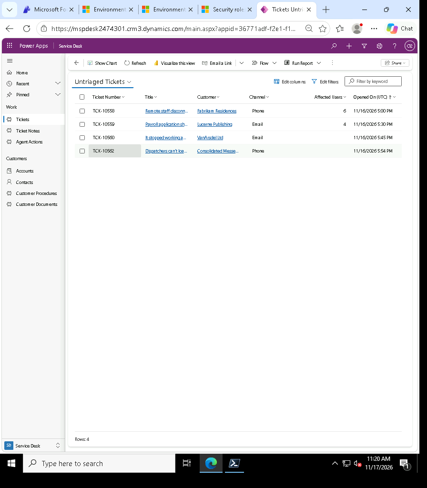

1. Ask the agent to find the closest historical tickets in your environment. In the Foundry portal, open the **Playground** tab of **msp-support-agent** (on the desktop, double-click **Microsoft Foundry**, select your project **<inject key="Foundry Project Name" enableCopy="false"/>**, select **Build**, and then select **msp-support-agent**). Select **New chat**, enter the following prompt, and press **Enter**.

   **Prompt:**

   ```
   A new incident, TCK-10561, is waiting in the Service Desk queue and is not in the knowledge index. Read it with the Service Desk tools first. Then find the historical tickets most similar to it, and any open ticket that looks like the same problem. For each one, give the ticket number, customer, title and knowledge article.
   ```

   **Expected Output:** the agent first reads TCK-10561 through **servicedesk-read**, so its answer restates details that no indexed document holds: **A. Datum Corporation**, status **New**, no priority or category, no new recovery points since Saturday night, and the cloud storage allowance used up after the archive copy. It then lists historical tickets resolved with **KB0023**, *RBA-2201: cloud vault storage quota exceeded*, for example **TCK-10004** (Contoso Pharmaceuticals, *Backup failed: RBA-2201 vault quota exceeded*), **TCK-10035** (Contoso Pharmaceuticals, *No new restore points: vault full*) and **TCK-10471** (Lucerne Publishing, *No new restore points: vault full*), and the open ticket **TCK-10521** (Trey Research, *Backup failing with RBA-2201 vault quota exceeded*), with citations.

   **What this validates:** the agent reaches a ticket that the index has never seen through an MCP read tool, and then matches it against history that it can cite.

   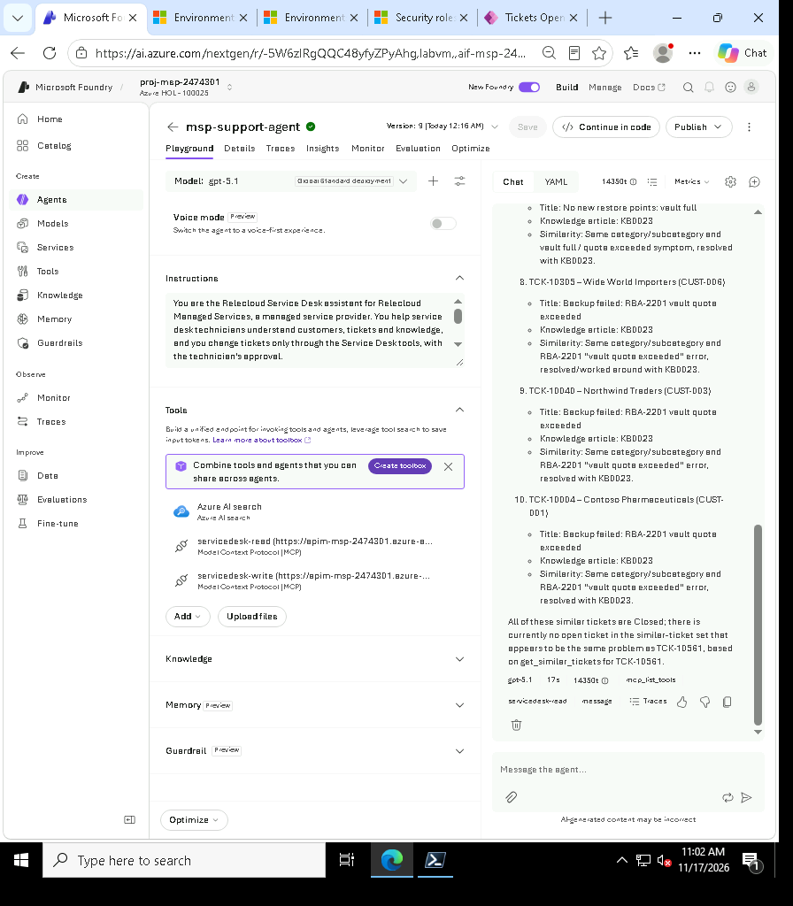

   > **Note:** The provided screenshot is for your reference; the output you receive may vary.

   > **Note:** The first time the agent calls a Service Desk tool in your playground, the chat can show **Open Consent** instead of an answer. Select **Open Consent**, sign in as <inject key="AzureAdUserEmail" enableCopy="false"/>, close the confirmation tab, and send the prompt again if the agent doesn't continue on its own. The two Service Desk connections pass your own identity to the gateway, so you consent once per connection, and Dataverse applies your Senior Technician role to every read. Read tools run without an approval request.

   > **Note:** The agent may also call `get_similar_tickets` on TCK-10561. The route doesn't matter; the list does. The agent doesn't have to list all ten historical KB0023 tickets, but every ticket it presents as a match must appear in the **Expected matches** table at the end of this task.

1. Ask it to explain what makes each one similar, beyond keyword overlap. In the same chat, enter the following prompt, and press **Enter**.

   **Prompt:**

   ```
   For each match, explain what makes it similar to TCK-10561 beyond shared words: the symptom, the cause, what changed just before it started, the product, and how it was resolved. Then name any tickets or articles that only look similar, and say why each one is a different problem.
   ```

   **Expected Output:** the explanation maps the incident's own words onto the history. *No new recovery points* is KB0023's symptom: new restore points are not created. *Cloud storage allowance used up* is its error, RBA-2201 *Vault quota exceeded*: the customer's contracted vault size is full. The drawing archive copied last week is the large data import that KB0023 names as the usual cause. The product is the Relecloud Backup Agent with its cloud vault, and the history was resolved the KB0023 way: check vault usage, confirm that the retention policy matches the contract, and ask the account manager to offer a vault size increase. The agent may also cite A. Datum's own profile, which says the project archive server is protected every night to the cloud vault and that the vault has a contracted allowance. The decoys it names come from the **Decoys** table at the end of this task, for example the open **TCK-10532** at A. Datum Corporation, *CAD workstation backup status Unknown*, where a device is offline and nothing is wrong with the vault.

   **What this validates:** the agent matches on the symptom, the cause and the trigger rather than on words: the incident never mentions a vault, a quota or RBA-2201, and several decoys share its customer or its product.

   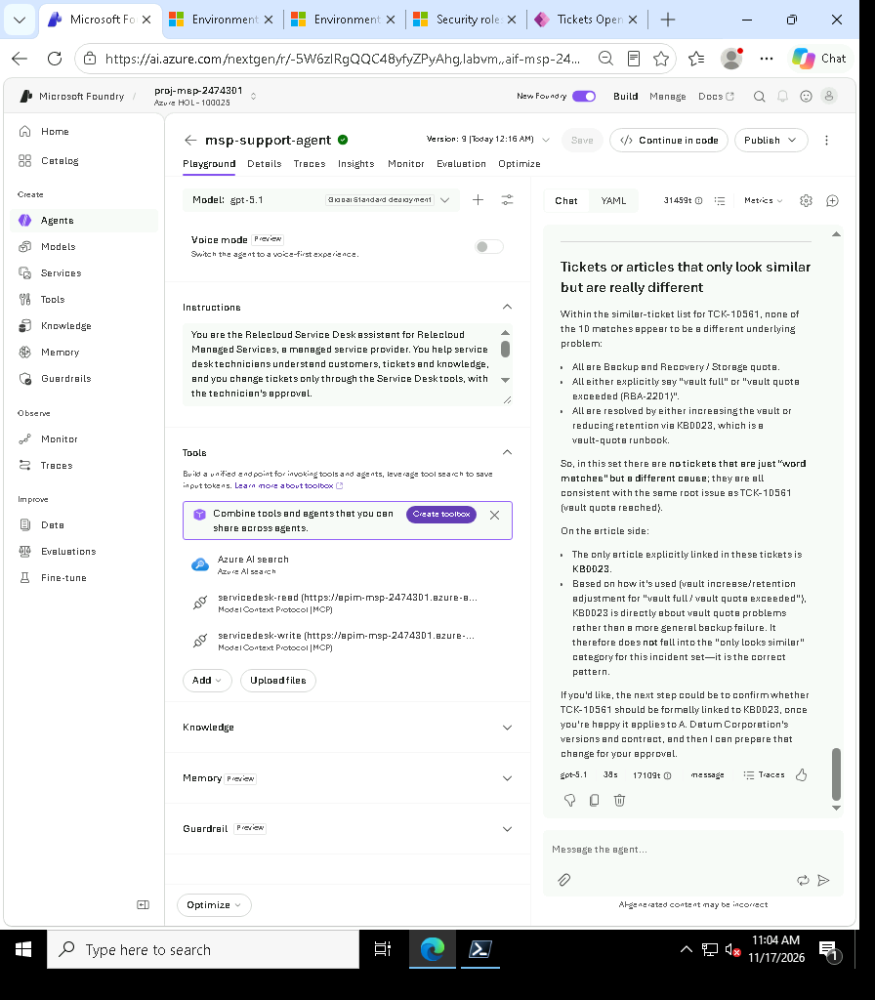

   > **Note:** The provided screenshot is for your reference; the output you receive may vary.

1. Open one of the results in the Service Desk app, confirm it is a genuine match, and compare your list with the expected matches. In the agent's answer, select the citation link for one historical ticket, for example **TCK-10035**: it opens the ticket in the Service Desk app. If your answer has no link for it, in the Service Desk app select **Work** > **Tickets**, select the **All Tickets** view, select the **Ticket Number** column header, select **Filter by**, enter the ticket number, and select **Apply**. Compare the record with what the agent said. For **TCK-10035**, the **Description** reports jobs failing with RBA-2201 *Vault quota exceeded*, **Related Article** is **KB0023**, **Priority** is **P3 Medium**, **Assigned Technician** is **Priya Raman**, **Escalation Level** is **Account Manager**, and the **Resolution Summary** says that the account manager agreed a vault increase with the customer and the jobs resumed.

   > **[SCREENSHOT PENDING: E2T1S4 | TCK-10035 in the Service Desk app with Related Article KB0023, Priority P3 Medium, Assigned Technician Priya Raman and Escalation Level Account Manager | source: capture]**

   Then compare the agent's list with the expected matches and the decoys.

   **Expected matches:** the ten historical tickets resolved with KB0023, and the open ticket with the same problem.

   | Ticket | Customer | Title |
   |---|---|---|
   | TCK-10004 | Contoso Pharmaceuticals | *Backup failed: RBA-2201 vault quota exceeded* |
   | TCK-10029 | Adventure Works Cycles | *No new restore points: vault full* |
   | TCK-10035 | Contoso Pharmaceuticals | *No new restore points: vault full* |
   | TCK-10040 | Northwind Traders | *Backup failed: RBA-2201 vault quota exceeded* |
   | TCK-10066 | Contoso Pharmaceuticals | *No new restore points: vault full* |
   | TCK-10104 | Bellows College | *No new restore points: vault full* |
   | TCK-10232 | Proseware Inc | *No new restore points: vault full* |
   | TCK-10305 | Wide World Importers | *Backup failed: RBA-2201 vault quota exceeded* |
   | TCK-10458 | Fabrikam Residences | *No new restore points: vault full* |
   | TCK-10471 | Lucerne Publishing | *No new restore points: vault full* |
   | TCK-10521 (open, **In Progress**) | Trey Research | *Backup failing with RBA-2201 vault quota exceeded* |

   All ten historical tickets were **P3 Medium**, handled by **Priya Raman** (TECH-01) and escalated to the **Account Manager**. You use this pattern in Task 3.

   **Decoys:** each one looks like the incident, but the cause is different.

   | Decoy | Why it is a different problem |
   |---|---|
   | **KB0012**, for example TCK-10061 (Bellows College) | The standard response to a failed job for Platinum and Gold customers; not a full vault |
   | **KB0013**, including A. Datum's own TCK-10467, *Backup failed twice for ADCFS01* | The standard response to a failed job for Silver and Bronze customers; not a full vault |
   | **KB0033**, for example TCK-10014 (Humongous Insurance) | Slow backups after vault encryption was turned on; restore points are still created |
   | **KB0036**, including A. Datum's own TCK-10391 and TCK-10428 | Large Outlook data files in file backups: an exclusion problem, not a storage limit |
   | **KB0039**, and the open TCK-10532 at A. Datum Corporation | A device that is offline and not reporting; nothing is wrong with the vault |
   | **KB0007**, for example TCK-10007 (Humongous Insurance) | Error RBA-1043, a snapshot timeout after patching |

   In **Lab notes.txt**, next to **TCK-10561: closest historical tickets, and why they are similar**, record the tickets the agent matched and the reason in one line, for example **KB0023 tickets such as TCK-10004 and TCK-10035, and the open TCK-10521: no new restore points because the vault quota is full after a large data import**.

### Expected results

- [ ] The agent's answer restates TCK-10561's details, which it could get only from the Service Desk tools, because the incident isn't in the index
- [ ] Its matches are tickets from the expected matches table, and it found the open **TCK-10521**
- [ ] Each explanation names the symptom, the cause and the trigger, not just shared words
- [ ] It named at least one decoy, for example **TCK-10532** or **KB0013**, and said why it is a different problem
- [ ] The ticket you opened in the app shows **KB0023**, **P3 Medium**, **Priya Raman** and **Account Manager**, as the agent said
- [ ] You recorded the matches and the reason in **Lab notes.txt**

### Troubleshooting

| Symptom | Likely cause | What to do |
|---|---|---|
| The agent says it can't find TCK-10561 | It searched only the index, which doesn't hold the two new incidents | Ask it to read TCK-10561 with the Service Desk tools, as the prompt says, and then search |
| The chat shows **Open Consent**, or the tool call fails with a sign-in or authorization error | You haven't consented to the **servicedesk-read** connection yet, or the browser is signed in with another account | Select **Open Consent** and sign in as <inject key="AzureAdUserEmail" enableCopy="false"/>, then send the prompt again |
| The agent presents RBA-1043 or failed-job tickets as matches | It matched on words such as *nightly* and *job* instead of the cause | Send the explanation prompt; if it still prefers them, ask which tickets had no new restore points because the vault was full |
| Validation fails right after you finish the task | The MCP server's tool invocation log reaches Log Analytics a few minutes after the call | Wait two or three minutes and validate again |

> **Congratulations** on completing the task! Now, it's time to validate it. Here are the steps:
> - Hit the Validate button for the corresponding task. If you receive a success message, you can proceed to the next task.
> - If not, carefully read the error message and retry the step, following the instructions in the lab guide.
> - If you need any assistance, please contact us at cloudlabs-support@spektrasystems.com. We are available 24/7 to help.

<validation step="REPLACE-WITH-VALIDATION-GUID" />

## Task 2: Summarize a Customer's Support History

In this task, you will produce the summary a support lead wants before calling a customer: what is open, what keeps coming back, and what was escalated before.

1. Pick a customer with several open tickets. Use **Woodgrove Bank** (CUST-007), a **Platinum**, **Fully Managed** customer: it has six open tickets, the most of any customer, and no other customer has more than three.

1. Ask the agent to summarize open issues by category or urgency, and how previous incidents for this customer were resolved. Select **New chat**, enter the following prompt, and press **Enter**.

   **Prompt:**

   ```
   Summarize Woodgrove Bank's support history from the live Service Desk data. Group its open tickets by category, and give each ticket's number, title, status, priority and remaining SLA business hours, most urgent first. Say how many open tickets it has. Then summarize how its previous incidents were resolved: how many resolved or closed tickets it has, and which knowledge articles resolved them most often.
   ```

   **Expected Output:** **6** open tickets:

   | Category | Ticket | Title | Status | Priority | SLA remaining (business hours) |
   |---|---|---|---|---|---|
   | Network and VPN | TCK-10548 | *VPN drops every hour for branch managers* | In Progress | P2 High | 6.0 of 8 |
   | Network and VPN | TCK-10553 | *Mortgage team kicked off VPN hourly* | New | P2 High | 6.5 of 8 |
   | Network and VPN | TCK-10518 | *Remote Access calls drop during long client calls* | Waiting on Customer | P3 Medium | 7.0 of 16 |
   | Printing | TCK-10531 | *Third floor printer offline after network change* | In Progress | P3 Medium | 11.0 of 16 |
   | Endpoint | TCK-10543 | *Laptop very slow since this week's agent update* | New | P3 Medium | 13.0 of 16 |
   | Email and Collaboration | TCK-10513 | *Shared mailbox access for the compliance team* | In Progress | P4 Low | 28.0 of 40 |

   For the history, the agent reports **35** resolved or closed tickets, resolved most often with **KB0055**, about choppy calls over Remote Access, and **KB0044**, about firewall rule change requests, on three tickets each. A strong answer also says when the SLA figures were calculated.

   **What this validates:** the agent separates what is open now from what is history, and ranks the open work by urgency rather than by ticket number.

   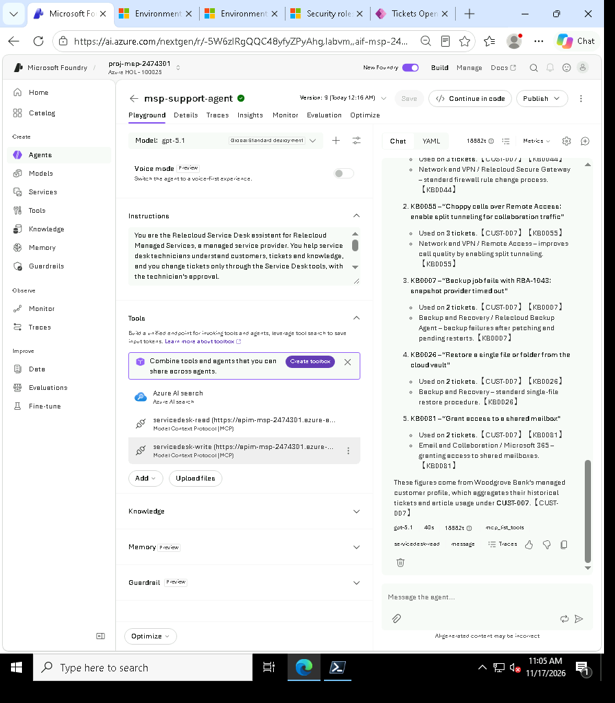

   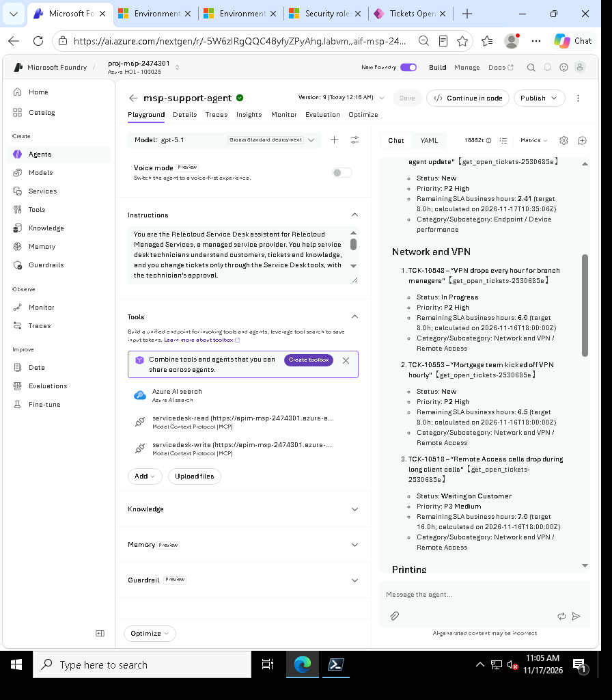

   > **Note:** The provided screenshot is for your reference; the output you receive may vary.

   > **Note:** The SLA figures are a snapshot taken at one time for every open ticket, shown in each ticket's **SLA Calculated On (UTC)** field, so they don't change while you work.

1. Ask it to flag anything recurring or previously escalated. In the same chat, enter the following prompt, and press **Enter**.

   **Prompt:**

   ```
   Flag any issue that recurs across Woodgrove Bank's tickets, with the knowledge article that explains it. Then list Woodgrove Bank's previous tickets that were escalated, with the escalation level and the article for each.
   ```

   **Expected Output:**

   - **Recurring:** the hourly Remote Access disconnects in **TCK-10518**, **TCK-10548** and **TCK-10553** are one issue since the Secure Gateway firmware rollout, explained by **KB0058**, *Remote Access tunnel resets hourly after Secure Gateway firmware 10.1*. Woodgrove Bank runs Remote Access client 4.2.0 on Secure Gateway firmware 10.1.4, so one gateway change addresses all three tickets. The agent may also link **TCK-10543** to **KB0067**, *Laptops slow after Endpoint Agent 7.4.0 update*, because Woodgrove Bank runs Endpoint Agent 7.4.0.
   - **Escalated before:** eight tickets. **TCK-10038**, **TCK-10086** and **TCK-10295** (KB0055) and **TCK-10368**, **TCK-10463** and **TCK-10499** (KB0044) went to the **L3 Specialist**. **TCK-10309** (KB0147, an unknown inbox rule after a phishing click) and **TCK-10432** (KB0143, a ransomware indicator) became a **Major Incident**.

   **What this validates:** the agent sees three tickets as one problem with one fix, and knows which kinds of Woodgrove Bank incident have needed more than the service desk.

   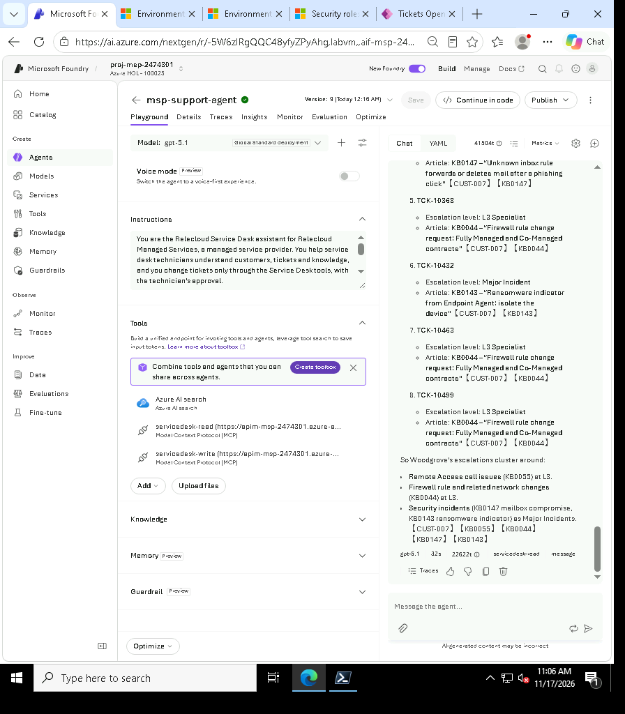

   > **Note:** The provided screenshot is for your reference; the output you receive may vary.

   > **Note:** If the agent lists fewer open or escalated tickets than above, it probably answered from the index alone: a knowledge search returns the closest matches, not every record. Ask it to use the Service Desk tools for Woodgrove Bank's tickets.

1. Verify the open ticket count against the Service Desk app. In the Service Desk app, select **Work** > **Tickets** and select the **Open Tickets** view. Select the **Customer** column header, select **Filter by**, choose **Woodgrove Bank**, and select **Apply**. The list shows **6** rows, the same six tickets as the agent's table. In **Lab notes.txt**, next to **Customer history: customer, open tickets the agent counted, open tickets in the app**, record **Woodgrove Bank (CUST-007), 6, 6**, or the count the agent gave if it differs.

   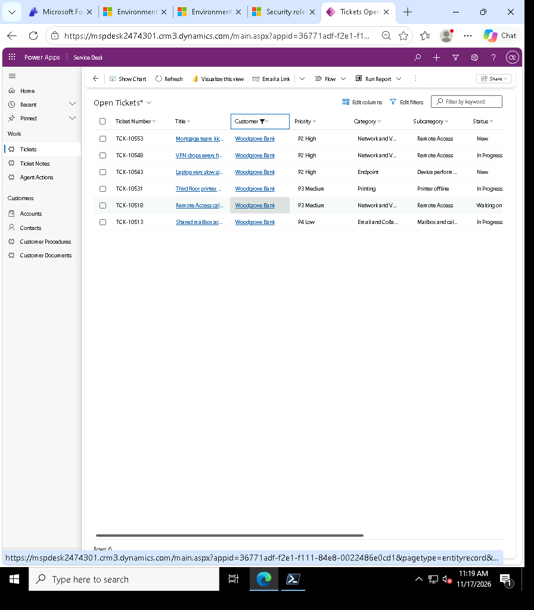

   > **Note:** If the column menu in your app has no **Filter by**, sort the list by the **Customer** column and count the Woodgrove Bank rows instead.

### Expected results

- [ ] The agent listed six open Woodgrove Bank tickets with their status, priority and remaining business hours, and no resolved or closed tickets among them
- [ ] It summarized the history: 35 resolved or closed tickets, resolved most often with KB0055 and KB0044
- [ ] It flagged **TCK-10518**, **TCK-10548** and **TCK-10553** as one recurring issue explained by **KB0058**
- [ ] It listed the escalated tickets with their levels: six to the **L3 Specialist** and two **Major Incident** escalations
- [ ] The **Open Tickets** view filtered on Woodgrove Bank shows six rows, and you recorded both counts

### Troubleshooting

| Symptom | Likely cause | What to do |
|---|---|---|
| The agent lists fewer than six open tickets, or includes resolved ones | It answered from the index, which returns the closest matches rather than every ticket, and holds each ticket's status as of the export | Ask it to list Woodgrove Bank's open tickets with the Service Desk tools |
| The answer has no remaining hours, or hours that don't match the app | The agent estimated them instead of reading the SLA fields | Ask it to quote each ticket's stored SLA figures and when they were calculated |
| The app shows more or fewer than six rows | Another view is selected, or the filter is on another column | Check that the view is **Open Tickets** and that the filter is on the **Customer** column with **Woodgrove Bank** |

## Task 3: Recommend Priority, Category and Assignment

In this task, you will see whether the agent triages by Relecloud's own pattern or by guesswork. A good recommendation names its evidence, and a good agent asks when there is no evidence to use.

1. Use the same new incident, which has no priority, category or technician set. **TCK-10561** is still untriaged: you only read it in Task 1, and the agent can't change a ticket without your approval.

1. Ask the agent to recommend priority, category and the technician or team, citing the historical pattern it used. Select **New chat**, enter the following prompt, and press **Enter**.

   **Prompt:**

   ```
   TCK-10561 has no priority, category or technician yet. Read it with the Service Desk tools, then recommend a category and subcategory, a priority, and the technician and team to assign it to. Cite the historical tickets and the knowledge article your recommendation follows, say what SLA target that priority gives this customer, and name the customer procedure, the contact and the escalation pattern that apply. Don't change the ticket.
   ```

   **Expected Output:**

   - **Category:** **Backup and Recovery**, subcategory **Storage quota**, the classification of the open TCK-10521, which has the same problem.
   - **Priority:** **P3 Medium**, the priority of all ten historical KB0023 tickets and of TCK-10521.
   - **Technician:** **Priya Raman** (TECH-01) of the **Infrastructure** team, L2 and available, with skills in the Relecloud Backup Agent, restores and vault storage. She handled all ten KB0023 tickets and has the open TCK-10521.
   - **SLA target:** **32** business hours, because A. Datum Corporation is a **Silver** customer and a Silver P3 Medium ticket has a 32-hour resolution target. The clock starts when the priority is set.
   - **Procedure and contact:** **CUST-019-PR3**, *Backup retention and vault size changes*: retention changes and vault size increases need written approval from the customer's IT manager, and the account manager, **Owen Fletcher**, quotes vault increases. The procedure also asks customers to announce large archive imports a week ahead so that the vault can be sized first.
   - **Escalation pattern:** every KB0023 ticket was escalated to the **Account Manager** for a vault quote, which is also what runbook **RB-002**, *Vault capacity and retention changes*, says to do.
   - **Sources:** KB0023 and historical tickets such as TCK-10004 and TCK-10035, and possibly A. Datum's documents **CDOC-019**, *Support policy: A. Datum Corporation*, and **CDOC-033**, *Configuration notes: A. Datum Corporation backup vault allowance*.

   **What this validates:** the triage follows Relecloud's own history and the customer's own procedure, and every part of it traces to a record you can open.

   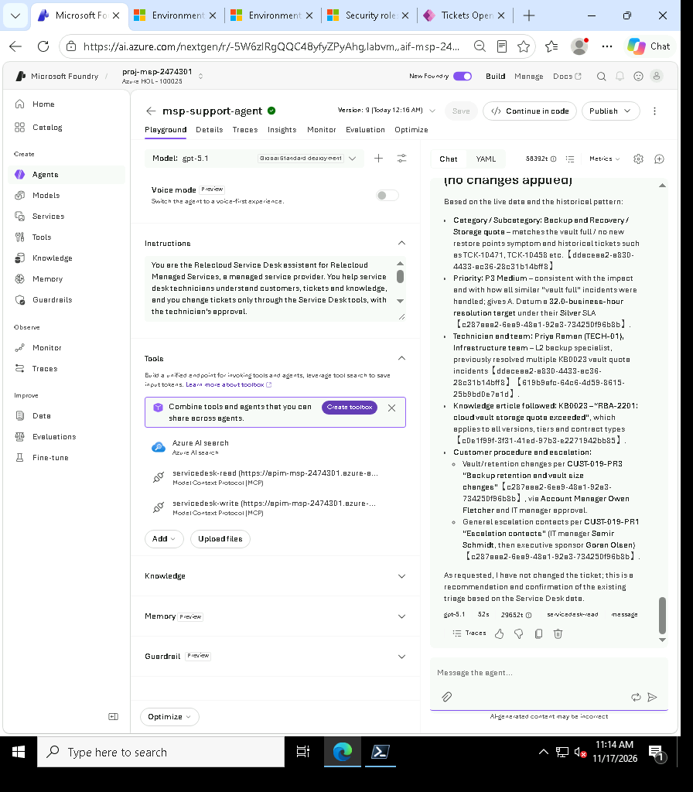

   > **Note:** The provided screenshot is for your reference; the output you receive may vary.

   In **Lab notes.txt**, next to **TCK-10561: recommended priority, category and technician or team**, record **P3 Medium, Backup and Recovery (Storage quota), Priya Raman (TECH-01, Infrastructure)**. Then, in the Service Desk app, select the **Untriaged Tickets** view again: TCK-10561 is still listed, with no priority, category or technician, and no approval request appeared in the chat. The agent recommends; it changes nothing without your approval, which you give in Exercise 4.

1. Open a seeded ticket with incomplete information and confirm the agent asks for what is missing rather than guessing. In the **Untriaged Tickets** view, open **TCK-10560**, *It stopped working again*, from **VanArsdel Ltd**. Its whole **Description** reads: "It stopped working again this morning, same as last time. Please fix it urgently, people are waiting." In the playground, select **New chat**, enter the following prompt, and press **Enter**.

   **Prompt:**

   ```
   Triage TCK-10560: recommend a priority, a category and a technician.
   ```

   **Expected Output:** the agent reads TCK-10560, says that it can't triage the ticket from what it contains, and lists what to ask VanArsdel Ltd: which system or application stopped working; the error message or what the users see; how many people are affected and where; and what happened "last time", as a ticket number or a date. It may show VanArsdel's earlier tickets as candidates for "last time", but it doesn't pick one, and it doesn't guess a cause, a priority or an article.

   **What this validates:** the agent asks instead of inventing a triage when a ticket lacks the facts a technician would need.

   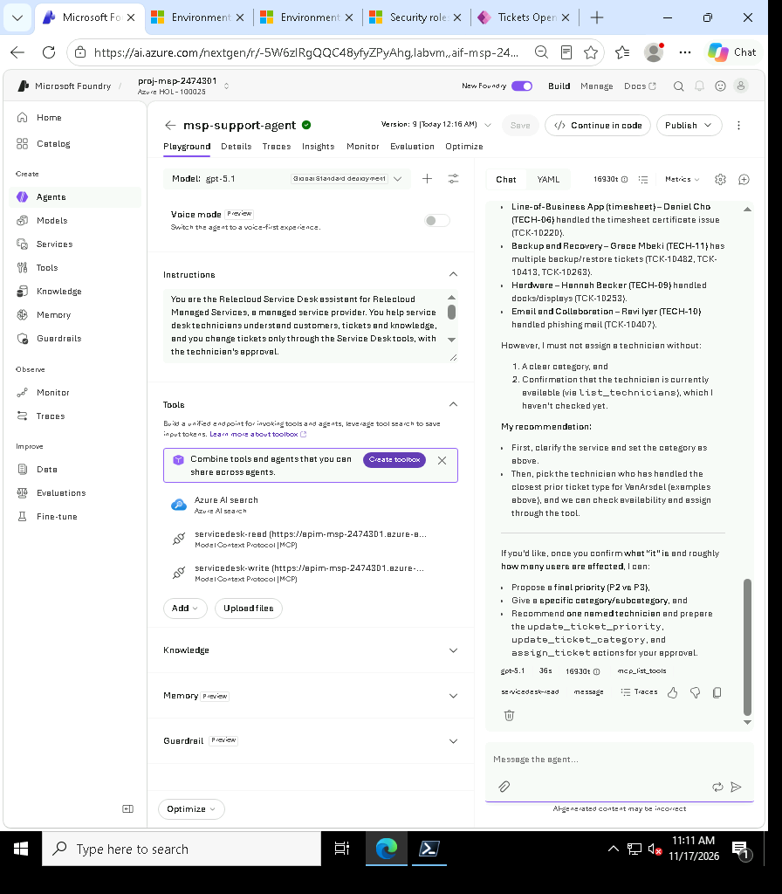

   > **Note:** The provided screenshot is for your reference; the output you receive may vary.

   In **Lab notes.txt**, next to **Incomplete ticket: what the agent asked for**, record the details it asked for.

### Expected results

- [ ] The TCK-10561 recommendation is **Backup and Recovery**, **Storage quota**, **P3 Medium** and **Priya Raman** (TECH-01, Infrastructure), with a **32**-business-hour target
- [ ] It cites KB0023 and historical tickets by number, procedure **CUST-019-PR3** with **Owen Fletcher**, and the **Account Manager** escalation
- [ ] TCK-10561 is still in the **Untriaged Tickets** view with no priority, category or technician, and no approval request appeared
- [ ] For TCK-10560, the agent asked for the system, the error, the people affected and what "last time" means, and recommended no priority
- [ ] You recorded both results in **Lab notes.txt**

### Troubleshooting

| Symptom | Likely cause | What to do |
|---|---|---|
| The agent recommends Marcus Webb or another Infrastructure technician | It chose by team instead of by the KB0023 history | Ask which technician handled the KB0023 tickets and whether that person is available. Marcus Webb (TECH-02) is on leave and must never be recommended |
| The agent recommends P2 or P1 because backups are failing | It applied general urgency instead of Relecloud's history | Ask it for the priority of the ten KB0023 tickets and of TCK-10521 |
| The agent triages TCK-10560 anyway | An earlier chat steered it, or it took the word *urgently* as enough to go on | Select **New chat** and send the prompt again; if it still guesses, record what it guessed next to **Incomplete ticket: what the agent asked for** |

## Task 4: Detect an SLA Risk

In this task, you will find the open tickets closest to breaching their resolution SLA and check the arithmetic yourself. Every SLA figure in the Service Desk counts business hours only: Monday to Friday, 08:00 to 18:00 UTC, with no holidays.

1. Ask the agent which open tickets are closest to breaching their resolution SLA. Select **New chat**, enter the following prompt, and press **Enter**.

   **Prompt:**

   ```
   Which open tickets are closest to breaching their resolution SLA? Use the live Service Desk data. List the three closest that have not breached yet, and list separately any that have already breached.
   ```

   **Expected Output:** closest to breach, in this order: **TCK-10540** (Contoso Pharmaceuticals, 0.5 business hours left), **TCK-10524** (Humongous Insurance, 1.0) and **TCK-10504** (Bellows College, 2.0). Already breached: **TCK-10501** (Tailspin Toys, 6.0 business hours past the target) and **TCK-10512** (Northwind Traders, 1.5 past). Every other open ticket has at least 6.0 business hours left.

   **What this validates:** the agent ranks risk by remaining business hours, and keeps the tickets that have already breached apart from the ones that can still be saved.

   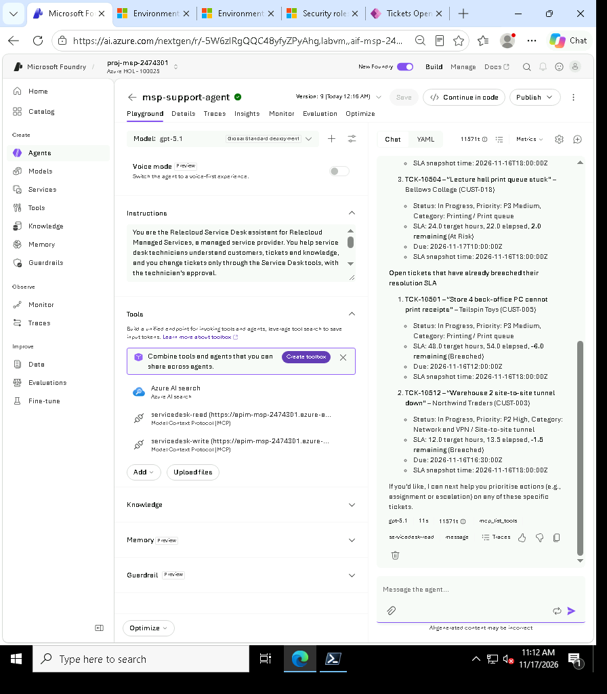

   > **Note:** The provided screenshot is for your reference; the output you receive may vary.

1. Ask it to show the working: priority, SLA target and elapsed business hours. In the same chat, enter the following prompt, and press **Enter**.

   **Prompt:**

   ```
   For each of those five tickets, show the customer and its SLA tier, the priority, the SLA target, the elapsed and remaining business hours, and when the figures were calculated. Then say which open tickets have no SLA yet, and why.
   ```

   **Expected Output:**

   | Ticket | Customer (SLA tier) | Priority | Target | Elapsed | Remaining | SLA status |
   |---|---|---|---|---|---|---|
   | TCK-10501 | Tailspin Toys (Bronze) | P3 Medium | 48.0 | 54.0 | -6.0 | Breached |
   | TCK-10512 | Northwind Traders (Gold) | P2 High | 12.0 | 13.5 | -1.5 | Breached |
   | TCK-10540 | Contoso Pharmaceuticals (Platinum) | P1 Critical | 4.0 | 3.5 | 0.5 | At Risk |
   | TCK-10524 | Humongous Insurance (Platinum) | P2 High | 8.0 | 7.0 | 1.0 | At Risk |
   | TCK-10504 | Bellows College (Gold) | P3 Medium | 24.0 | 22.0 | 2.0 | At Risk |

   In every row, the target minus the elapsed hours gives the remaining hours, and a negative value is the time past the target. The figures were calculated at the same moment for every open ticket, 14:00 UTC. The tickets without an SLA are the untriaged ones, because with no priority there is no target and no clock: **TCK-10558**, **TCK-10559** and **TCK-10560**, and, when the agent reads the live data, the two new incidents **TCK-10561** and **TCK-10562**.

   **What this validates:** every number in the risk list can be recomputed from the ticket's own fields, in business hours, at a stated time.

   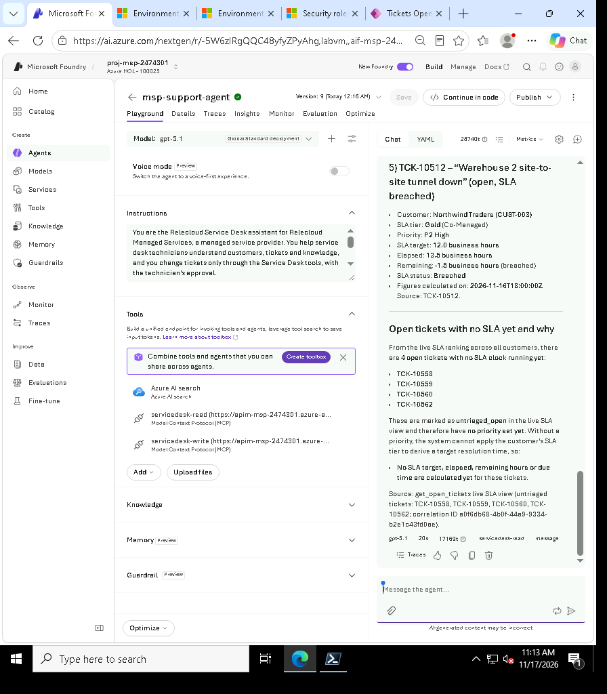

   > **Note:** The provided screenshot is for your reference; the output you receive may vary.

   > **Note:** The knowledge index also holds an SLA snapshot document, **SLA-SNAPSHOT**, with the same figures. It was exported before provisioning loaded the two new incidents, so it lists only TCK-10558, TCK-10559 and TCK-10560 as untriaged. TCK-10561 and TCK-10562 have no SLA yet either, but only the live data shows them.

   In **Lab notes.txt**, next to **SLA risk: ticket closest to breach, and the working**, record **TCK-10540: P1 Critical, target 4.0, elapsed 3.5, remaining 0.5 business hours, calculated at 14:00 UTC**.

1. Verify one result against the SLA fields on the ticket record itself. In the Service Desk app, select **Work** > **Tickets**, select the **Open Tickets** view, and open **TCK-10540**, *Laboratory building network down*. In its **SLA** section, compare the fields with the agent's working. **Opened On (UTC)** is 10:30 AM and **SLA Calculated On (UTC)** is 2:00 PM (14:00) on the same day, which is 3.5 business hours. **SLA Target (business hours)** is **4.00**, **SLA Elapsed (business hours)** is **3.50** and **SLA Remaining (business hours)** is **0.50**. **SLA Due On (UTC)** is 2:30 PM (14:30) the same day, and **SLA Status** is **At Risk**. In the **Escalation** section, **Escalation Level** is **Major Incident**.

   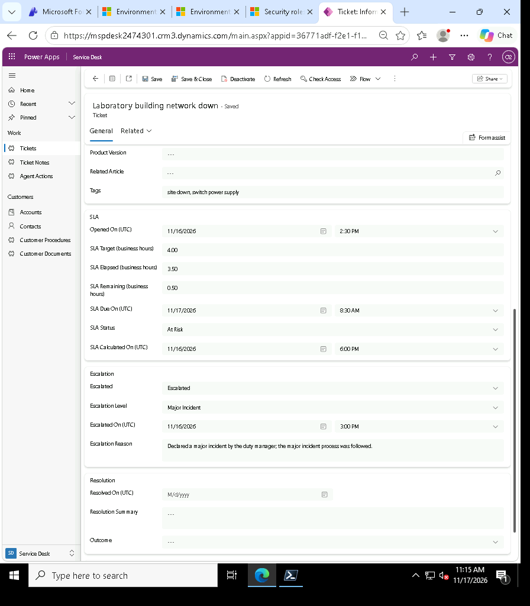

   Then select the **Open Tickets by SLA Remaining** view. Its first five rows are **TCK-10501**, **TCK-10512**, **TCK-10540**, **TCK-10524** and **TCK-10504**, in the same order as the agent's table, and the view holds **57** tickets: the 62 open tickets minus the five untriaged ones, which have no remaining hours.

   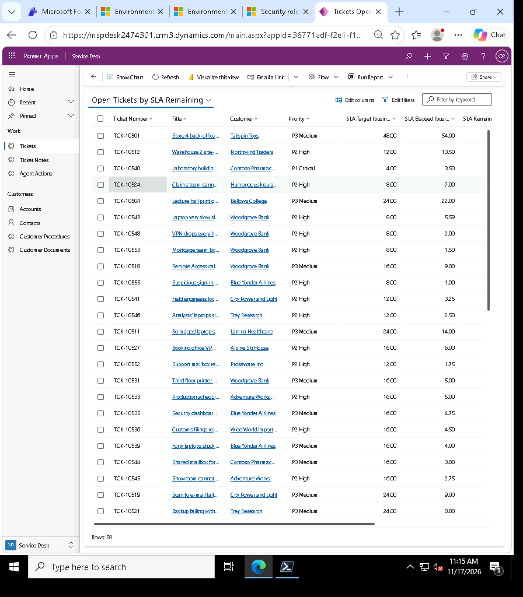

### Expected results

- [ ] The three tickets closest to breach are **TCK-10540**, **TCK-10524** and **TCK-10504**, in that order
- [ ] **TCK-10501** and **TCK-10512** are reported as breached, not as at risk
- [ ] Each of the five rows shows the priority, target, elapsed and remaining business hours, and the answer says when the figures were calculated
- [ ] The **SLA** section of TCK-10540 matches the agent's figures for it
- [ ] The **Open Tickets by SLA Remaining** view starts with the same five tickets and holds 57
- [ ] You recorded the closest ticket and its working in **Lab notes.txt**

### Troubleshooting

| Symptom | Likely cause | What to do |
|---|---|---|
| The elapsed hours are larger than in the table, or count nights and weekends | The agent recalculated the SLA from the current time, or in calendar hours, instead of reading the stored figures | Ask it to quote each ticket's stored SLA fields and **SLA Calculated On (UTC)** without recalculating them |
| A breached ticket appears among the three closest | The agent ranked by the size of the number and ignored the sign | Ask it to treat negative remaining hours as breached and list those tickets separately |
| TCK-10561 and TCK-10562 are not in the **Open Tickets by SLA Remaining** view | They have no priority, so no SLA target and no remaining hours | Nothing to fix: until a ticket has a priority, it can't appear in an SLA ranking |

## Success Criteria

You have completed this exercise when:

- [ ] The agent read TCK-10561 through its Service Desk tools, matched it to KB0023 tickets and the open **TCK-10521**, and explained each match by symptom, cause and trigger
- [ ] The Woodgrove Bank summary had six open tickets, the recurring KB0058 issue and the escalation levels, and the app showed six open tickets
- [ ] The recommendation for TCK-10561 is **Backup and Recovery**, **Storage quota**, **P3 Medium**, **Priya Raman** and **32** business hours, with the records it rests on
- [ ] The SLA ranking separated two breached tickets from three at risk, and the record of **TCK-10540** matched the agent's working
- [ ] **Lab notes.txt** holds the five Exercise 2 values
- [ ] Negative check: for TCK-10560 the agent asked for the missing details instead of triaging, and TCK-10561 still has no priority, category or technician, because the agent changed nothing

## Apply It in Production

**What you built:**

- A triage assistant that reaches a ticket the index has never seen through a governed read tool, and matches it to history by symptom, cause and trigger, not by shared words.
- Recommendations that cite their pattern, from an agent that asks when a ticket is too vague to triage.
- An SLA ranking in business hours that keeps breached tickets apart from those you can still save.

**Decisions to make before production:**

1. **Freshness.** New tickets reach the agent only through tools until the next indexing run. Decide how often to index resolved tickets, so that today's resolution helps tomorrow's match.
1. **Recommend or apply.** Decide which triage fields, if any, the agent may ever set without approval. Keep priority and assignment behind approval until you have measured how often technicians accept its recommendations.
1. **Where SLA is calculated.** Keep the calculation in the ticketing system, on its own calendar and holidays, and let the agent read it rather than compute it.
1. **Enough history.** Ten consistent tickets are a pattern; one is an anecdote. Decide the minimum evidence behind a recommendation.

**Production checklist:**

- [ ] Each recommendation is logged with the records it cites, so that you can measure acceptance
- [ ] A set of vague tickets tests, before every release, that the agent asks instead of guessing
- [ ] Technician availability comes from live data, so no recommendation names someone on leave
- [ ] SLA alerts come from the ticketing system; the agent is a second reader, not the only one
- [ ] The retrieval test set includes decoys: the same customer or product with a different cause

**Common pitfalls:**

| Pitfall | How to avoid it |
|---|---|
| The agent matches on shared words and recommends the fix for another cause | Ask for the symptom, cause and trigger behind each match, and test with decoys |
| SLA risk counted in calendar hours makes nights and weekends look like breaches | Keep SLA figures in business hours with their calculation time, and have the agent quote them |

## Knowledge Check

**Question 1:** TCK-10561 never mentions a vault, a quota or RBA-2201. How did the agent still match it to KB0023?

<details>
<summary>Show the answer</summary>

It read the incident with a Service Desk read tool, because the incident isn't in the index, and then searched the index you built in Exercise 1. That index holds a vector of every document's content, made with `text-embedding-3-small`, so a search matches meaning as well as words: "no new recovery points" sits close to "new restore points are not created", and "cloud storage allowance used up" sits close to "vault quota exceeded". Asking for the symptom, cause and trigger behind each match then confirms it, instead of trusting a search score.

</details>

**Question 2:** TCK-10561 and TCK-10521 are both P3 Medium problems. Why is the SLA target for TCK-10561 32 business hours, when the target for TCK-10521 is 24?

<details>
<summary>Show the answer</summary>

The target depends on the customer's SLA tier as well as on the priority. A. Datum Corporation is a Silver customer, and a Silver P3 Medium ticket has a 32-hour resolution target. Trey Research is a Gold customer, and a Gold P3 Medium ticket has a 24-hour target.

</details>

**Question 3:** The queue holds 62 open tickets, but the **Open Tickets by SLA Remaining** view lists 57. Which tickets are missing, and what does that mean for SLA monitoring?

<details>
<summary>Show the answer</summary>

The five untriaged tickets: TCK-10558, TCK-10559, TCK-10560 and the two new incidents, TCK-10561 and TCK-10562. In this Service Desk, a ticket without a priority has no SLA target, so no SLA ranking can see it. A ticket that waits untriaged is invisible to SLA monitoring, which is why fast triage matters as much as the SLA ranking itself.

</details>

## Summary

In this exercise, you have completed the following:

- Matched the new incident TCK-10561, which the agent reached only through its Service Desk tools, to the KB0023 history and the open TCK-10521, and told the decoys apart.
- Summarized Woodgrove Bank's six open tickets, its history, the recurring KB0058 issue and its escalations, and verified the count in the Service Desk app.
- Got a cited priority, category and assignment recommendation for TCK-10561, and saw the agent ask for the missing details on TCK-10560 instead of guessing.
- Ranked the open tickets by SLA risk in business hours and verified the working for TCK-10540 on its record.

#### You have successfully completed this exercise. Click **Next >>** from the lower right corner to proceed to the next exercise.
