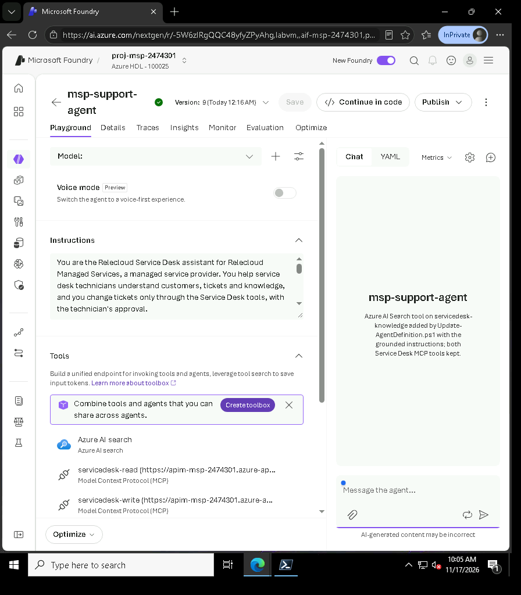
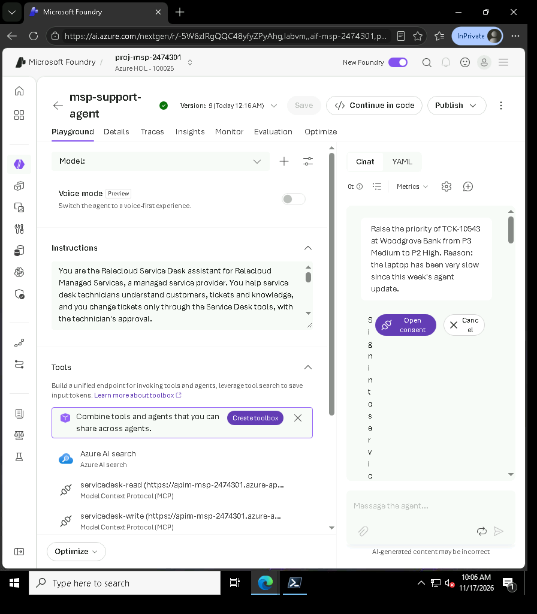
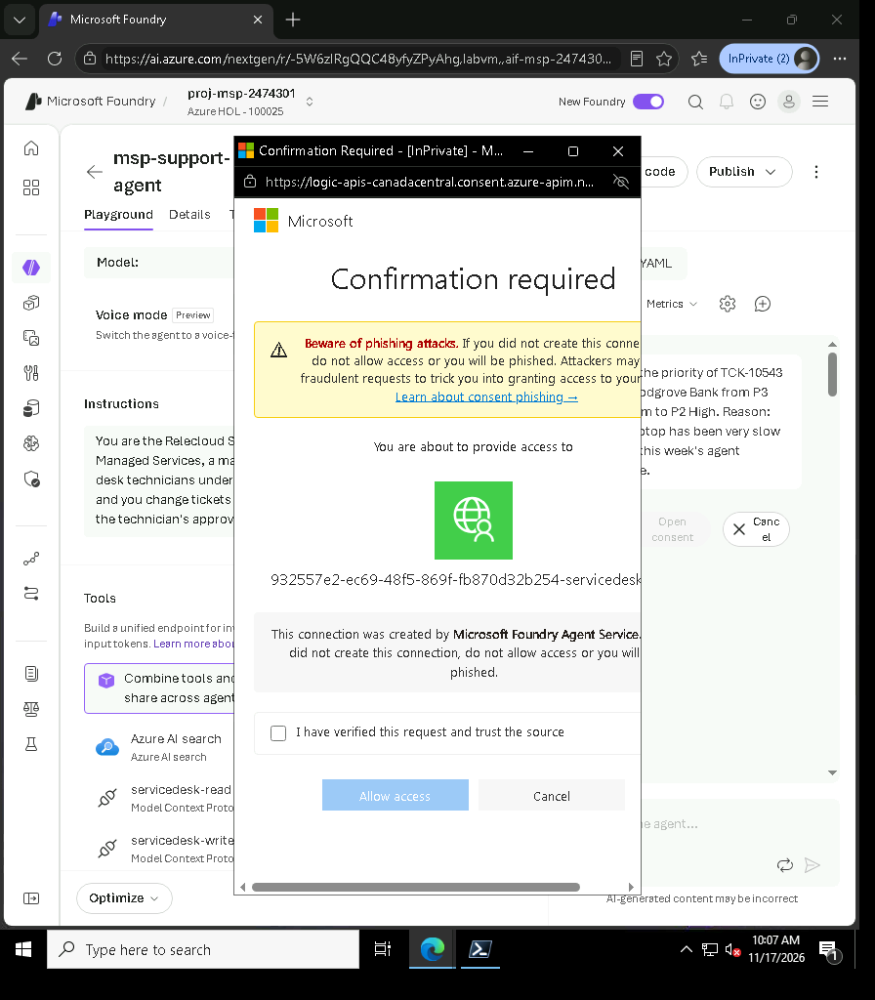

# Exercise 5: Identity, Secrets and Authorization

### Estimated Duration: 30 minutes

## Scenario

"Whose permissions does the agent use, and can it ever do more than the person asking?" Relecloud's CISO asks it before the agent changes another ticket. Relecloud's 15 technicians don't all hold the same rights: a Tier 1 Technician reads tickets, a Senior Technician also changes them, and one customer, Lamna Healthcare, has its records kept in a business unit of its own because of a regulated-data contract. An agent that acted with broad credentials of its own would erase those differences, and a credential left in code would let anyone who reads the repository act as the server. In this exercise you name the identity and the token at every hop of a write, prove that the backend credential exists only in Azure Key Vault, narrow the agent's write role so that Dataverse itself refuses a change to a Lamna Healthcare ticket, and show the same request denied for a Tier 1 Technician and allowed for you, through the same agent and the same MCP server.

## Overview

In this exercise, you map the five identities behind one write and the token each hop presents, with `Get-AgentIdentity.ps1`, the Microsoft Entra admin center, the gateway's policy and the Power Platform admin center. You confirm that the MCP server reads its backend key, `mcp-backend-key`, from Key Vault through its managed identity when it starts, and that neither its repository nor its Container App holds a secret. Then you narrow the **Service Desk Agent Write** role to one business unit, watch Dataverse refuse the agent's change to **TCK-10511**, and finish with the same priority change on **TCK-10543**, first as the Tier 1 Technician and then as yourself.


How to read this diagram: the six boxes across the top are the hops of one write, from left to right. You sign in with Microsoft Entra ID as the Tier 1 or the Senior Technician; **msp-support-agent** has its own Entra Agent ID and no Dataverse rights; the OAuth connection **servicedesk-write** gets your token; API Management validates your token and forwards who you are; the MCP server calls Dataverse as its app user (**id-mcp-123456** stands for your **<inject key="MCP Backend Identity Name" enableCopy="false"/>**); and Microsoft Dataverse checks your role and the server's role. The cards under the hops say what each one holds: the agent identity has no Dataverse permission and is not in the token the gateway receives; your token carries the gateway app as its audience (`aud`), the scope `ServiceDesk.Access` (`scp`) and your object ID (`oid`); the gateway adds `x-correlation-id`, your object ID and the backend key from Key Vault; and the Azure Key Vault card shows `mcp-backend-key`, read at startup by the MCP server's identity and by the gateway. The animation plays the same request, raising TCK-10543 from P3 Medium to P2 High, twice. In the first pass the **SIGNED IN AS** card shows the Tier 1 Technician with a read-only role, the **BOTH ROLES MUST ALLOW** card turns to *No Write: denied*, and the card at the bottom left lights up: denied by Dataverse with PrivilegeDenied 0x80040220, nothing changed, logged as Denied by Dataverse. In the second pass the card shows the Senior Technician, the roles card turns to *Write allowed*, and the card at the bottom right lights up: TCK-10543 is now P2 High, changed on the technician's behalf, and Dataverse audits the change. Tasks 1 and 2 follow the top row and its cards, and in Task 4 you play both passes yourself. The business unit boundary you add in Task 3 isn't drawn.

## Objectives

In this exercise, you will complete the following tasks:

- Task 1: Map the Identities and Token Flow
- Task 2: Verify Secure Secret Handling
- Task 3: Enforce a Least-Privilege Boundary
- Task 4: Apply User-Level Authorization

## Task 1: Map the Identities and Token Flow

In this task, you will find the identity behind every hop of one write and the token each hop presents. Every hop from you through the agent and the MCP server to Dataverse runs as a defined identity: find each one.

1. Identify the user identity, the agent's Microsoft Entra Agent ID, the gateway, the MCP server's managed identity and the Dataverse application user. The user is you, the Senior Technician, <inject key="AzureAdUserEmail" enableCopy="false"/>; in Task 4 it is also the Tier 1 Technician. Start with the agent. In PowerShell 7, run the following command, which reads the agent's identity from the Foundry API and prints the identity that each hop of a Service Desk tool call uses. It changes nothing:

   ```powershell
   C:\LabFiles\tools\Get-AgentIdentity.ps1
   ```

   Under **The agent and its Microsoft Entra Agent ID**, **Agent ID client ID** is the value you recorded in Exercise 1 next to **Agent ID (client ID)**, and **Agent ID object ID** is the object ID of the same identity; the two values can be the same. Under **Its tools (latest version)**, **servicedesk-read** shows the approval **never**, **servicedesk-write** shows **always** (if it shows *never for N tool(s)*, an **Always approve** option was selected on an approval request: run `C:\LabFiles\tools\Update-AgentDefinition.ps1 -Reset` and then `C:\LabFiles\tools\Update-AgentDefinition.ps1 -Instructions` to restore approval on every write), and the Azure AI Search tool is the knowledge source you added in Exercise 1. The table **Which identity each hop of a Service Desk tool call uses** lists six hops: **1. You**, **2. The agent**, **3. The MCP connections**, **4. API Management**, **5. MCP server** and **6. Dataverse**.

   > **[SCREENSHOT PENDING: E5T1S1-1 | PowerShell 7 window with Get-AgentIdentity.ps1 output: the Agent ID object ID and client ID, the tools table and the six-hop identity map | source: capture]**

   Then find each identity where it lives:

   - **The agent's Microsoft Entra Agent ID.** On the desktop, double-click **Microsoft Entra admin center**, select **Entra ID** > **Agents** > **Agent identities**, and search for the **Agent ID object ID**. The agent identity is listed with its own object ID, separate from your account. Open it, and keep the tab open for step 3.
   - **The gateway.** In the Azure portal, open the API Management instance **<inject key="API Management Name" enableCopy="false"/>** and select **APIs** > **Named values**. **mcp-gateway-app-id** is the application ID of the gateway app registration, **Relecloud Service Desk MCP Gateway**, whose tokens are the only ones the gateway accepts; **mcp-gateway-audience** is <inject key="MCP Gateway Audience" enableCopy="false"/>; **mcp-gateway-scope** is `ServiceDesk.Access`; and **agent-id** is your agent's **Agent ID client ID**. **mcp-backend-key** has the type **Key vault**: you meet it again in Task 2.
   - **The MCP server's managed identity.** **<inject key="MCP Backend Identity Name" enableCopy="false"/>**, with the client ID <inject key="MCP Backend Identity Client ID" enableCopy="false"/>. Hop **5. MCP server** of the script's map names it, together with the Container App **<inject key="Container App Name" enableCopy="false"/>** that uses it.
   - **The Dataverse application user.** In a new tab, browse to `https://admin.powerplatform.microsoft.com`. Select **Manage** > **Environments**, select your environment, **Relecloud Service Desk <inject key="DeploymentID" enableCopy="false"/>**, and select **Settings**. Select **Users + permissions** > **Application users**, select the application user named after **<inject key="MCP Backend Identity Name" enableCopy="false"/>**, and select **Details**. **Microsoft Entra application ID** is the MCP Backend Identity Client ID; **Assigned security roles** are **Service Desk Agent Read**, **Service Desk Agent Write** and **Delegate**; and **Business unit** is your environment's root business unit. Dataverse maps every token of the managed identity to this user. Keep this tab open for step 3 and Task 3.

   > **[SCREENSHOT PENDING: E5T1S1-2 | Microsoft Entra admin center, Entra ID > Agents > Agent identities, with the agent identity found by its object ID | source: capture]**

   > **[SCREENSHOT PENDING: E5T1S1-3 | Power Platform admin center, Application users, Details of the id-mcp application user with its Microsoft Entra application ID and the roles Service Desk Agent Read, Service Desk Agent Write and Delegate | source: capture]**

   In **Lab notes.txt**, next to **Identities on one write: user, Agent ID, gateway, MCP managed identity, Dataverse application user**, record the five, for example **me (Senior Technician); the Agent ID client ID; <inject key="API Management Name" enableCopy="false"/> with the gateway app Relecloud Service Desk MCP Gateway (ServiceDesk.Access); <inject key="MCP Backend Identity Name" enableCopy="false"/>; its application user with Service Desk Agent Read, Service Desk Agent Write and Delegate**.

   > **Note:** Viewing agent identities needs no administrator role. Search by object ID: the display name that Foundry gives an agent identity isn't documented and can vary. The agent's sign-in logs need the Reports Reader role, which lab accounts don't hold.

   > **Note:** The Power Platform admin center has no desktop shortcut. Your account holds no tenant administrator role; in Dataverse, its **Service Desk Security Steward** role lets it manage the environment's security roles. If the admin center doesn't list your environment, or **Settings** isn't available, see Troubleshooting.

1. For one write action, trace which token is presented at each hop and what it is scoped to. Take the write you approved in Exercise 4 and recorded next to **Approved write: ticket, change and correlation ID (you trace it in Exercise 6)**. First see how the gateway treats your token. In the API Management instance, select **APIs** > **MCP servers**, select **Service Desk MCP (write)**, and under **MCP**, select **Policies**. In the `inbound` section:

   - `validate-azure-ad-token` accepts only a token issued in your tenant to the gateway app (`client-application-ids`), for the gateway's audience (`audiences`), that carries the scope `ServiceDesk.Access` in its `scp` claim (`required-claims`). Any other call gets **401**.
   - The `set-header` lines copy your object ID and name from the validated token into `x-user-oid` and `x-user-name`, add the agent's ID from the **agent-id** named value as `x-agent-id`, the correlation ID as `x-correlation-id`, and the backend key from Key Vault as `x-backend-key`.
   - `<set-header name="Authorization" exists-action="delete" />` then removes your token: the MCP server never receives it.

   > **[SCREENSHOT PENDING: E5T1S2 | API Management, Service Desk MCP (write) policy with validate-azure-ad-token, the x-user-oid and x-backend-key headers and the deletion of Authorization | source: capture]**

   > **Note:** Some portal versions label the menu **MCP Servers**. Your account can read the policy but not change it.

   That gives the token, or the key, that each hop of the write presents:

   | Hop | What is presented | Scoped to |
   |---|---|---|
   | You to Microsoft Foundry | Your own sign-in to the Foundry portal | Microsoft Foundry, where you chat with the agent and approve each write |
   | **servicedesk-write** connection to API Management | Your delegated token, which the connection obtained through OAuth identity passthrough when you selected **Open Consent** | Audience (`aud`): the gateway app, as its application ID in a v2 token. Scope (`scp`): `ServiceDesk.Access`. Object ID (`oid`): yours. The agent's ID isn't in it |
   | API Management to the MCP server | No token: the backend key `x-backend-key` from Key Vault, with `x-user-oid`, `x-user-name`, `x-agent-id` and `x-correlation-id` | The MCP server's write endpoint, `/write/mcp`, in your Container App only |
   | MCP server to Key Vault, at startup | A token of the MCP server's managed identity | Azure Key Vault (`https://vault.azure.net`) |
   | MCP server to Dataverse | A token of the MCP server's managed identity, plus the header `CallerObjectId` set to your object ID | Your Dataverse environment (`<environment URL>/.default`), with the call made on your behalf |

   In **Lab notes.txt**, next to **Tokens: what each hop presents and its scope**, record one short line per hop, for example **my token for the gateway app (scp ServiceDesk.Access, oid me) to API Management; no token to the MCP server, only the Key Vault key and my object ID; id-mcp tokens for Key Vault and Dataverse, with CallerObjectId set to me**.

   > **Note:** The two Service Desk connections use OAuth identity passthrough, so the token the gateway validates names you, not the agent, and the gateway adds the agent's ID from its own configuration. The flow that would carry both identities in one token, the agent acting on behalf of the user, is in preview and doesn't run in the Foundry portal playground, so this lab uses passthrough as the closest working equivalent.

1. Confirm the agent holds no direct permission on Dataverse. In the Microsoft Entra admin center tab from step 1, look at the agent identity's details: they list its parent blueprint and its owners and sponsors, and no permission or role granted to it. Foundry creates every agent identity with no permissions of its own. Then, in the Power Platform admin center tab, go back to **Application users**. The list holds the application users of the MCP server's identity, **<inject key="MCP Backend Identity Name" enableCopy="false"/>**, of the lab VM's provisioning identity, and of **Relecloud Lab Setup <inject key="DeploymentID" enableCopy="false"/>**, the app that built your environment and lost its credentials when provisioning ended. None of them is the agent: their **Details** show **Microsoft Entra application ID** values other than the agent's client ID. The agent reaches Dataverse only by calling a tool, and every tool call arrives in Dataverse as the MCP server's application user acting for the technician who asked.

   > **[SCREENSHOT PENDING: E5T1S3 | Agent identity details in the Microsoft Entra admin center with no permissions or roles granted | source: capture]**

   > **Note:** Dataverse can also hold agents as users (a preview, under **Users + permissions** > **Agents**). Provisioning adds none, so if your environment shows that page, **msp-support-agent** isn't on it.

1. Record which permissions are delegated from the user, and which belong to the application. Sort what you found:

   | Delegated from you, the signed-in technician | Belonging to an application (a workload identity) |
   |---|---|
   | The scope `ServiceDesk.Access` on the gateway app, consented for every user of your tenant during provisioning and used by both Service Desk connections | The MCP server's managed identity: **Service Desk Agent Read**, **Service Desk Agent Write** and **Delegate** in Dataverse, **Key Vault Secrets User** on your key vault, and **AcrPull** on your container registry |
   | Your Dataverse role, **Service Desk Senior Technician**, which Dataverse applies to every call made on your behalf | API Management's managed identity (its name starts with `id-apim-`): **Key Vault Secrets User**, to read `mcp-backend-key` for its named value |
   | Your decision on each write, in the approval request | The app registration **Relecloud Service Desk Purview Integration**: the Microsoft Graph application permissions `Content.Process.User` and `ProtectionScopes.Compute.User` |
   | | The agent's Microsoft Entra Agent ID: none |

   Dataverse allows a call made on your behalf only when both sides hold the privilege: your role, which is delegated, and the application user's roles. **Delegate** carries the privilege **Act on Behalf of Another User**, which is what lets the application user act for you at all. In **Lab notes.txt**, add to your **Tokens: what each hop presents and its scope** line, for example **delegated: ServiceDesk.Access and my Dataverse role; application: id-mcp's Dataverse roles and Key Vault Secrets User**.

### Expected results

- [ ] `Get-AgentIdentity.ps1` showed the agent's Agent ID, with the client ID you recorded in Exercise 1, and the six hops of a tool call
- [ ] The Microsoft Entra admin center lists the agent identity by its object ID, with no permission or role granted to it
- [ ] The named values hold the gateway app's ID, the audience <inject key="MCP Gateway Audience" enableCopy="false"/> and the scope `ServiceDesk.Access`, and the write policy deletes `Authorization` before it forwards a call
- [ ] The application user of **<inject key="MCP Backend Identity Name" enableCopy="false"/>** holds **Service Desk Agent Read**, **Service Desk Agent Write** and **Delegate**, and no application user belongs to the agent
- [ ] **Lab notes.txt** holds your identities line and your tokens line, including which permissions are delegated and which belong to applications

### Troubleshooting

| Symptom | Likely cause | What to do |
|---|---|---|
| `Get-AgentIdentity.ps1` stops with *Azure CLI has no sign-in for your lab tenant* | Your Azure CLI sign-in expired | Run `az login`, sign in as the Senior Technician, and run the script again |
| Searching **Agent identities** finds nothing | You searched by name, or the list hasn't refreshed | Search by the **Agent ID object ID** from the script, and refresh the page |
| The Power Platform admin center doesn't list your environment, or **Settings** isn't available | Opening the admin center with only Dataverse roles, without a tenant administrator role, is still being confirmed for lab accounts | Contact support with your Deployment ID. The documented fallback gives your account System Administrator in this environment only. After support confirms the role, sign out of the admin center and sign in again (with your Temporary Access Pass) so the environment list refreshes |

## Task 2: Verify Secure Secret Handling

In this task, you will check how the MCP server gets the one credential it runs on, and that the credential is nowhere else. The MCP server must not run on a static credential embedded in code.

1. Locate the MCP server's backend credential in Azure Key Vault. In the Azure portal, open the key vault **<inject key="Key Vault Name" enableCopy="false"/>** and select **Objects** > **Secrets**. The list shows **mcp-backend-key**, the key that API Management adds to every call it forwards to the MCP server; **apim-diagnostics-key**, the subscription key of the diagnostics API that the lab VM's readiness check uses; and, when Microsoft Purview is set up in your environment, **purview-client-secret**, the secret of the Purview integration app. Select **mcp-backend-key** and then its current version: you can read its properties, such as its content type, *Shared key that API Management sends to the MCP server as x-backend-key*, but not its value. Your role on the vault is **Key Vault Reader**, which reads the properties of secrets and never their values. Only two identities can read the value: the managed identities of the MCP server and of API Management, which hold **Key Vault Secrets User**. To see the refusal for yourself, run the following command in PowerShell 7. It asks Key Vault for the secret and prints only the secret's ID, so no value appears even if the read were allowed:

   ```powershell
   az keyvault secret show --vault-name <inject key="Key Vault Name" enableCopy="false"/> --name mcp-backend-key --query id --output tsv
   ```

   The command fails with a **Forbidden** error: Key Vault refuses the read for your account and records the refusal in its audit log, which you look at in step 4.

   > **[SCREENSHOT PENDING: E5T2S1 | Key vault Secrets list with mcp-backend-key and its properties visible to a Key Vault Reader, and the az keyvault secret show command refused with Forbidden | source: learn https://learn.microsoft.com/azure/key-vault/media/rbac/image-12.png]**

   > **Note:** Some portal versions list **Secrets** directly in the key vault's menu instead of under **Objects**. The wording of the Azure CLI error depends on its version; what matters is that no value comes back.

1. Confirm the MCP server reads it through its managed identity at runtime. On the desktop, double-click **MCP server (VS Code)** and open `src\servicedesk_mcp\keyvault.py`. `read_secret` asks the server's managed identity for a token for Key Vault (the constant `VAULT_SCOPE`, `https://vault.azure.net/.default`) and reads the secret over the Key Vault REST API, and `load_secrets` reads `mcp-backend-key` once, when the server starts and before it accepts any call. The managed identity is the one whose client ID is in the Container App's `AZURE_CLIENT_ID` setting, which you see in step 3. Then find the server's own record of those reads. In the Azure portal, open the Log Analytics workspace **<inject key="Log Analytics Workspace" enableCopy="false"/>** and select **Logs**. If the query editor opens in simple mode, switch it to **KQL mode**. Run the following query, which lists the MCP server's Key Vault reads and startup lines of the last three days:

   ```kql
   ContainerAppConsoleLogs
   | where TimeGenerated > ago(3d) and ContainerAppName startswith "ca-mcp-"
   | extend entry = parse_json(Log)
   | where tostring(entry.event) in ("key_vault_secret_read", "startup")
   | project TimeGenerated, RevisionName, event = tostring(entry.event), secret = tostring(entry.secret),
             version = tostring(entry.version), key_source = tostring(entry.gateway_key_source)
   | order by TimeGenerated desc
   ```

   Every start of the server, at provisioning and at each redeploy you made in Exercises 3 and 4, left a `key_vault_secret_read` line for **mcp-backend-key** (and one for **purview-client-secret** when Microsoft Purview checks are on), followed within seconds by a `startup` line with the server's **version** and the **key_source** `key vault`. The newest pair belongs to the revision that runs now. Note its time: you match it with the vault's own log in step 4.

   > **[SCREENSHOT PENDING: E5T2S2 | Log Analytics results with key_vault_secret_read and startup lines for each MCP server revision, key_source key vault | source: capture]**

   > **Note:** The server's console lines reach Log Analytics a few minutes after they're written. The lines you need come from the server's starts in Exercises 3 and 4, so they're already there.

1. Search the repository and the Container App configuration and confirm no secret appears in either. In PowerShell 7, run the following command, which searches every file of your MCP server repository, including files you added and didn't commit, for the secret's name:

   ```powershell
   git -C C:\LabFiles\mcp-server grep -n --untracked "mcp-backend-key"
   ```

   Every hit is the name, never a value: the settings table in `README.md`, the default of `BACKEND_KEY_SECRET_NAME` in `config.py`, the description at the top of `keyvault.py`, and unit tests that use made-up values. Then run the following command, which searches the same files for strings shaped like credentials: a private key, a storage account key, a shared access signature or an access token:

   ```powershell
   git -C C:\LabFiles\mcp-server grep -n -I -E --untracked -e "PRIVATE KEY-----" -e "AccountKey=" -e "SharedAccessSignature=" -e "eyJ[A-Za-z0-9_-]{20,}\.eyJ"
   ```

   It prints nothing. Now check the Container App. Run the following command, which lists the secrets stored in the app's configuration:

   ```powershell
   az containerapp secret list --name <inject key="Container App Name" enableCopy="false"/> --resource-group <inject key="Resource Group Name" enableCopy="false"/> --output json
   ```

   It returns `[]` or prints nothing: the app stores no secret. Then run the following command, which lists the app's environment variables:

   ```powershell
   az containerapp show --name <inject key="Container App Name" enableCopy="false"/> --resource-group <inject key="Resource Group Name" enableCopy="false"/> --query "properties.template.containers[0].env[].{name:name, value:value}" --output table
   ```

   Every value is a setting, a name or an address. `KEY_VAULT_URL` is your vault; `BACKEND_KEY_SECRET_NAME` holds the secret's name, `mcp-backend-key`, and `PURVIEW_CLIENT_SECRET_NAME` the name `purview-client-secret`; `AZURE_CLIENT_ID` is the MCP Backend Identity Client ID; and `DATAVERSE_URL`, `AGENT_ID`, `GOLDEN_ENVIRONMENT_VERSION` and the `MCP_` paths are plain configuration. No variable holds a key.

   > **[SCREENSHOT PENDING: E5T2S3 | PowerShell 7 window with the two git grep searches, az containerapp secret list returning an empty list, and the table of environment variables | source: capture]**

   > **Note:** In the Azure portal, the app's secrets are under the Container App's **Security** > **Secrets**; some portal versions show **Settings** > **Secrets**. Anyone who can manage a Container App can also read its app secrets, which is one more reason the key lives only in Key Vault.

1. Review the Key Vault access log entry recorded when the MCP server started. On the same **Logs** page, run the following query. Key Vault writes its audit events to one of two tables, depending on how its diagnostic setting is configured, so the query reads both:

   ```kql
   union isfuzzy=true
     (AZKVAuditLogs
      | where TimeGenerated > ago(3d) and OperationName == "SecretGet" and Id contains "mcp-backend-key"
      | project TimeGenerated, AppId = tostring(Identity.claim.appid), Caller = tostring(Identity), Status = tostring(HttpStatusCode)),
     (AzureDiagnostics
      | where TimeGenerated > ago(3d) and ResourceProvider == "MICROSOFT.KEYVAULT" and OperationName == "SecretGet"
      | where tostring(column_ifexists("requestUri_s", "")) contains "mcp-backend-key"
      | project TimeGenerated, AppId = tostring(column_ifexists("identity_claim_appid_g", "")),
                Caller = tostring(column_ifexists("identity_claim_upn_s", "")), Status = tostring(column_ifexists("httpStatusCode_d", "")))
   | order by TimeGenerated desc
   ```

   Every row is a **SecretGet** on **mcp-backend-key**, and three kinds of caller appear:

   - Rows with **Status** **200** whose **AppId** is the MCP Backend Identity Client ID, <inject key="MCP Backend Identity Client ID" enableCopy="false"/>: the MCP server's managed identity, one row at each start of the server, in the same minute as the `key_vault_secret_read` lines from step 2.
   - Rows with **Status** **200** and another **AppId**: API Management's managed identity, which reads the same secret for its **mcp-backend-key** named value and refreshes it every few hours.
   - A row with **Status** **403** and your account in **Caller**: your refused read from step 1.

   No other identity read the value. In **Lab notes.txt**, next to **Backend credential: Key Vault secret name, and the access log entry at startup**, record the secret and the newest startup row, for example **mcp-backend-key; SecretGet at 10:42 UTC by the MCP Backend Identity Client ID, status 200, the same minute as the server's startup line**.

   > **[SCREENSHOT PENDING: E5T2S4 | Log Analytics results with SecretGet rows for mcp-backend-key: status 200 by the MCP server's identity at each start, status 200 by API Management's identity, and the refused read with status 403 | source: capture]**

   > **Note:** Key Vault audit events usually reach Log Analytics 3 to 10 minutes after the request, so your refused read from step 1 can be missing for a few minutes. The startup reads are older and are already there.

### Expected results

- [ ] **mcp-backend-key** is in the key vault, you could read its properties, and Key Vault refused your read of its value
- [ ] `keyvault.py` reads the key with a token of the managed identity, and the MCP server's log shows a Key Vault read and a `startup` line with the **key_source** `key vault` for each revision
- [ ] The repository holds the secret's name and no credential, the Container App stores no secret (`[]` or no output), and its environment variables hold only settings, names and addresses
- [ ] The vault's audit log shows **SecretGet** on **mcp-backend-key** with status **200** by the MCP Backend Identity Client ID at the server's startup time
- [ ] You recorded the secret and its startup log entry in **Lab notes.txt**

### Troubleshooting

| Symptom | Likely cause | What to do |
|---|---|---|
| The **Secrets** page shows an access error | The portal is signed in with another account, or a role assignment hasn't reached the portal yet | Check the account at the top right of the portal; role assignments can take several minutes to show in the portal. If it persists, contact support |
| The Key Vault query returns no row | The audit events are older than the time range, or the vault's diagnostic setting hasn't delivered them | Change `ago(3d)` to `ago(7d)` in both halves of the query and run it again. If there's still no row, contact support: the vault's audit log should hold every start of the server |
| `git` reports *not a git repository* | The path is wrong | Use `C:\LabFiles\mcp-server`, the folder that the **MCP server (VS Code)** shortcut opens |
| An `az` command fails with a sign-in or authorization error | Your Azure CLI sign-in expired | Run `az login` as the Senior Technician and run the command again |

## Task 3: Enforce a Least-Privilege Boundary

In this task, you will narrow the agent's write role and make Dataverse refuse a change it allowed before. The denial must come from Dataverse, not from your own code: the MCP server stays exactly as it is.

1. Review the security roles already assigned; the baseline is least privileged with read and write separated. In the Power Platform admin center tab, with your environment open, select **Settings** > **Users + permissions** > **Security roles**. Besides the predefined roles, the list holds six Service Desk roles:

   | Role | Held by | What it allows |
   |---|---|---|
   | **Service Desk Agent Read** | The MCP server's application user, the lab VM's provisioning identity, and the team that owns Lamna Healthcare's records | Read on the Service Desk tables, at **Organization** level |
   | **Service Desk Agent Write** | The MCP server's application user | The only changes the agent can make: ticket fields, ticket notes and Agent Action records. No read |
   | **Service Desk Senior Technician** | You | Read and write on tickets and ticket notes, read on the other Service Desk tables, and the audit history |
   | **Service Desk Security Steward** | You | Edit security roles and column security profiles in this environment. It isn't System Administrator |
   | **Service Desk Tier 1 Technician** | The Tier 1 Technician | Read only |
   | **Service Desk Readiness Read** | The lab VM's provisioning identity | Read on users, roles, teams and business units, for the readiness check |

   The MCP server's application user also holds the predefined **Delegate** role, as you saw in Task 1. Select **Service Desk Agent Write**. On the **Tables** tab, under **Custom Tables**, the role grants these privileges, all at **Organization** level:

   - **Ticket**: **Write**, **Append** and **Append to**
   - **Ticket Note**: **Create**, **Write**, **Append** and **Append to**
   - **Agent Action**: **Create** and **Append**
   - **Technician** and **Knowledge Article**: **Append to**

   Every other privilege is **None**: no **Read**, which comes from the separate read role, and no **Delete**, **Assign** or **Share** anywhere. Then go back to the environment's **Settings** and select **Users + permissions** > **Business units**: **Relecloud Regulated Accounts** is a child of your environment's root business unit. It holds the regulated customer, Lamna Healthcare (CUST-014), a **Gold**, **Fully Managed** customer: its 96 records, including 25 tickets such as **TCK-10511**, are owned by that business unit's team. You, the Tier 1 Technician, the MCP server's application user and every other record belong to the root business unit.

   > **[SCREENSHOT PENDING: E5T3S1 | Service Desk Agent Write in the security role editor, Tables tab, Custom Tables with Ticket Write, Append and Append to at Organization | source: capture]**

   > **Note:** The role editor can show a compact grid; the privileges and their menus are the same. You can filter the **Tables** tab to show only the privileges the role assigns.

1. Narrow one boundary further, for example no access to one customer's records. In the environment's **Settings**, select **Users + permissions** > **Security roles** again, and open **Service Desk Agent Write**. On the **Tables** tab, enter `Ticket` in the search box at the upper right and press **Enter**: two tables match, **Ticket** and **Ticket Note**. In the **Ticket** row, open the **Write** menu and select **Business Unit**. Leave every other privilege as it is, and select **Save + close**.

   The application user can now change only tickets owned in its own business unit, the root, and none of Lamna Healthcare's. Its other privileges are unchanged, so the agent still reads Lamna Healthcare's tickets and can still attach notes to them, because **Append to** on **Ticket** stays at **Organization**.

   > **[SCREENSHOT PENDING: E5T3S2 | Service Desk Agent Write, Ticket row with Write set to Business Unit and Append and Append to still at Organization | source: capture]**

   > **Note:** Some versions of the role editor show **Save** instead of **Save + close**. Dataverse lets you change a privilege on a role only if you hold that privilege yourself; your Senior Technician role holds Write on tickets at **Organization** level, so this change is allowed. Wait about a minute before step 3: Dataverse caches permissions for up to about 30 seconds after a role change, and the MCP server asks Dataverse for the latest permissions on every request.

1. Attempt the now-forbidden action through your agent. In the Foundry portal, on the **Playground** tab of **msp-support-agent**, select **New chat**, enter the following prompt, and press **Enter**.

   **Prompt:**

   ```
   Raise the priority of TCK-10511 at Lamna Healthcare from P4 Low to P3 Medium. Reason: the reimaged laptop still shows offline in the console.
   ```

   If the agent describes the change and asks you to confirm in the chat, reply `Yes, go ahead.` When the approval request for **update_ticket_priority** appears, check that its arguments name **TCK-10511** and priority **3**, and select **Approve**. Approving leaves the decision to Dataverse.

   **Expected Output:** the agent may first read **TCK-10511**, *Reimaged laptop shows offline in console*, which still works: your role and the application user's role both allow reading it. The approved call then fails, and the agent tells you that Dataverse refused the change and that the action isn't permitted, without retrying or looking for another way to make it. **TCK-10511** keeps **P4 Low**.

   **What this validates:** the same kind of write that succeeded in Exercise 4 is refused once the record lies outside the application user's business unit, while the MCP server's code hasn't changed.

   > **[SCREENSHOT PENDING: E5T3S3 | Playground with the approved update_ticket_priority call on TCK-10511 and the agent reporting that Dataverse refused the change | source: capture]**

   > **Note:** The provided screenshot is for your reference; the output you receive may vary.

1. Confirm the refusal originates from Dataverse and capture the error the platform returned. In the same chat, enter the following prompt, and press **Enter**.

   **Prompt:**

   ```
   Show me the exact error the tool returned for that call: the error code, its source, the Dataverse status, code and message, and the correlation ID.
   ```

   **Expected Output:** the error code **DATAVERSE_ACCESS_DENIED** with the source **dataverse**, and the platform's own answer passed through unchanged: status **403**, the code **0x80048306** when Dataverse sends one (the code can be empty), and a message in the pattern `<principal> with id <ID> does not have <right> right(s) for record with id <ID> of entity <table>`, followed by advice to assign a role with a wider access level. Then the `correlation_id`.

   **What this validates:** the refusal is Dataverse's own access check. The MCP server only passes the platform's status, code and message on, and nothing in its code knows about Lamna Healthcare or business units.

   > **[SCREENSHOT PENDING: E5T3S4-1 | Agent answer quoting DATAVERSE_ACCESS_DENIED, source dataverse, status 403, the code 0x80048306 and the Dataverse message, with the correlation ID | source: capture]**

   > **Note:** The provided screenshot is for your reference; the output you receive may vary.

   Then confirm it in the MCP server's own log. On the **Logs** page of the Log Analytics workspace, run the following query, which lists the tool calls on TCK-10511:

   ```kql
   ContainerAppConsoleLogs
   | where TimeGenerated > ago(1d) and ContainerAppName startswith "ca-mcp-"
   | extend entry = parse_json(Log)
   | where tostring(entry.event) == "tool_call" and tostring(entry.arguments.ticket_number) == "TCK-10511"
   | project TimeGenerated, tool = tostring(entry.tool), user = coalesce(tostring(entry.user.upn), tostring(entry.user.name)),
             outcome = tostring(entry.outcome), authorization = tostring(entry.authorization.result),
             decided_by = tostring(entry.authorization.decided_by), error_code = tostring(entry.error_code),
             backend_calls = entry.backend_calls, correlation_id = tostring(entry.correlation_id)
   | order by TimeGenerated desc
   ```

   The **update_ticket_priority** row shows your account as **user**, the **outcome** `denied`, the **authorization** `Denied by Dataverse`, **decided_by** `dataverse` and the **error_code** `DATAVERSE_ACCESS_DENIED`. Its **backend_calls** list the Dataverse requests the server made on your behalf, ending with a `PATCH` on `spk_tickets` that returned **403**, with its Dataverse request ID. A **get_ticket** row with the **outcome** `ok` is there too if the agent read the ticket first. In **Lab notes.txt**, next to **Boundary you narrowed, and the Dataverse error**, record the change and the error, for example **Service Desk Agent Write: Ticket Write from Organization to Business Unit; update_ticket_priority on TCK-10511 refused by Dataverse with 403 and 0x80048306**, followed by the correlation ID.

   > **[SCREENSHOT PENDING: E5T3S4-2 | Log Analytics row for update_ticket_priority on TCK-10511: outcome denied, Denied by Dataverse, decided by dataverse, PATCH with status 403 | source: capture]**

   > **Note:** The MCP server's log lines reach Log Analytics a few minutes after the call. If the query doesn't show the **update_ticket_priority** row yet, wait two or three minutes and run it again.

   > **Note:** Leave **Ticket** **Write** at **Business Unit**. Nothing later in the lab changes a ticket outside your root business unit: Exercises 6 and 7 work on TCK-10521 at Trey Research, TCK-10524 at Humongous Insurance and TCK-10562 at Consolidated Messenger, and the reviewers see the boundary as you left it. Your own Senior Technician role is unchanged: the narrower role limits the agent, not you.

### Expected results

- [ ] **Service Desk Agent Write** held write privileges only, and the agent's reads came from the separate **Service Desk Agent Read** role
- [ ] **Ticket** **Write** in **Service Desk Agent Write** is now **Business Unit**
- [ ] The approved **update_ticket_priority** call on **TCK-10511** failed with **DATAVERSE_ACCESS_DENIED** from **dataverse** and status **403**, and TCK-10511 is still **P4 Low**
- [ ] The MCP server's log shows the call as `Denied by Dataverse`, decided by `dataverse`, with a `PATCH` that returned **403**
- [ ] You recorded the boundary and the Dataverse error in **Lab notes.txt**

### Troubleshooting

| Symptom | Likely cause | What to do |
|---|---|---|
| Saving the role fails, for example with *RoleUpdateValidationFailure* (0x80048d3c) | Dataverse lets you change only privileges you hold yourself, or your account can't edit roles in this environment | Check that you changed only **Write** on **Ticket**. If saving still fails, contact support with your Deployment ID |
| The change to TCK-10511 succeeds | The role wasn't saved, or the call ran before the change took effect | Open **Service Desk Agent Write** and check that **Write** on **Ticket** shows **Business Unit**. If it does, contact support before you try again: each successful call changes TCK-10511 |
| No approval request appears | The agent is waiting for your confirmation in the chat | Reply `Yes, go ahead.` |
| Validation fails right after the task | The MCP server's log reaches Log Analytics a few minutes after the call | Wait two or three minutes and validate again |

> **Congratulations** on completing the task! Now, it's time to validate it. Here are the steps:
> - Hit the Validate button for the corresponding task. If you receive a success message, you can proceed to the next task.
> - If not, carefully read the error message and retry the step, following the instructions in the lab guide.
> - If you need any assistance, please contact us at cloudlabs-support@spektrasystems.com. We are available 24/7 to help.

<validation step="REPLACE-WITH-VALIDATION-GUID" />

## Task 4: Apply User-Level Authorization

In this task, you will send the same request through the same agent as two different people and see Dataverse decide differently for each. The agent must not gain more access than the person using it.

1. Sign in as your Tier 1 Technician, whose Dataverse role is read-only on tickets. On the lab VM, in Microsoft Edge, press **Ctrl+Shift+N** to open an **InPrivate** window, which keeps this sign-in apart from your own. Browse to the following address:

   ```
   https://ai.azure.com
   ```

   Sign in with the Tier 1 Technician's account:

   - **Email/Username:** <inject key="Tier 1 Technician Username" enableCopy="true"/>
   - **Temporary Access Pass:** the Tier 1 Technician's pass on the **Environment** tab

   > **Note:** The page may say **Enter Temporary Access Pass** or simply **Enter password**. Paste the same value either way. If you're asked to set up a passkey or the Microsoft Authenticator app, select **Skip for now**, and if you see **Stay signed in?**, select **No**.

   Select your project **<inject key="Foundry Project Name" enableCopy="false"/>**, select **Build**, select **msp-support-agent**, and open the **Playground** tab. This account holds no Microsoft Entra directory role, and in Dataverse only the **Service Desk Tier 1 Technician** role: read on the Service Desk tables, and no Write.

   

   > **Note:** The Tier 1 Technician needs **Foundry User** on your project to open the portal playground; **Foundry Agent Consumer** alone shows *You don't have permission to create a project* and no project. If the Foundry portal doesn't show the project or the agent's playground to this account, contact support with your Deployment ID.

1. Ask the agent to change a ticket's priority and confirm the request is denied for this user. In the InPrivate window, select **New chat**, enter the following prompt, and press **Enter**.

   **Prompt:**

   ```
   Raise the priority of TCK-10543 at Woodgrove Bank from P3 Medium to P2 High. Reason: the laptop has been very slow since this week's agent update.
   ```

   The first time this account calls a Service Desk tool, the chat shows **Open Consent**. Select it, sign in as the Tier 1 Technician in the tab that opens, close the confirmation tab, and send the prompt again if the agent doesn't continue on its own. It happens once for each connection, **servicedesk-read** and **servicedesk-write**. If the agent asks you to confirm in the chat, reply `Yes, go ahead.` When the approval request for **update_ticket_priority** appears, check that it names **TCK-10543** and priority **2**, and select **Approve**: the decision is left to Dataverse.

   

   

   **Expected Output:** the agent can read **TCK-10543** for this account, because the Tier 1 role reads tickets. The approved call fails, and the agent says the change isn't permitted for this user. If you ask for the exact error, it is **DATAVERSE_ACCESS_DENIED** from **dataverse** with status **403**, the code **0x80040220** (PrivilegeDenied) when Dataverse sends one, and a message that says a principal *is missing* the Write privilege on the ticket table (`prvWritespk_Ticket`) and suggests adding it to one of the principal's roles. Ask the agent for the call's `correlation_id` if its answer doesn't show it.

   **What this validates:** the same agent, server and tool, on a ticket that the application user may still change: the refusal comes from the Tier 1 Technician's own role, which Dataverse applies to every call the server makes on that person's behalf.

   > **[SCREENSHOT PENDING: E5T4S2-2 | Tier 1 Technician's playground with the approved update_ticket_priority call on TCK-10543 refused by Dataverse | source: capture]**

   > **Note:** The provided screenshot is for your reference; the output you receive may vary.

   In **Lab notes.txt**, next to **Tier 1 attempt (denied) and Senior attempt (allowed), with correlation IDs**, record the Tier 1 Technician's correlation ID. Then close the InPrivate window.

1. Make the same request as the Senior Technician and confirm it succeeds with the same agent and the same MCP server. Back in your own Edge window, open the Service Desk app, select **Work** > **Tickets**, select the **All Tickets** view, select the **Ticket Number** column header, select **Filter by**, enter `TCK-10543`, and select **Apply**. Open **TCK-10543**, *Laptop very slow since this week's agent update*, from **Woodgrove Bank**: **Priority** is still **P3 Medium** and **SLA Target (business hours)** is **16**, so the Tier 1 Technician's attempt changed nothing. Then, on the **Playground** tab of **msp-support-agent**, select **New chat**, enter the same prompt, and press **Enter**.

   **Prompt:**

   ```
   Raise the priority of TCK-10543 at Woodgrove Bank from P3 Medium to P2 High. Reason: the laptop has been very slow since this week's agent update.
   ```

   When the approval request for **update_ticket_priority** appears, check that it names **TCK-10543** and priority **2**, and select **Approve**.

   **Expected Output:** the agent confirms that **TCK-10543** is now **P2 High**, with a new SLA target of **8** business hours, and gives the call's `correlation_id`. In the Service Desk app, select **Refresh** on TCK-10543: **Priority** is **P2 High**, **SLA Target (business hours)** is **8**, and **Last Correlation ID** in the **Traceability** section holds the correlation ID of your change.

   **What this validates:** the same agent, MCP server, tool and arguments, and only the person changed. Dataverse allowed the call because your role and the application user's role both hold Write on this ticket, which is owned in the root business unit.

   > **[SCREENSHOT PENDING: E5T4S3 | Senior Technician's playground with the approved update_ticket_priority call, and TCK-10543 in the Service Desk app with Priority P2 High, SLA Target 8 and the Last Correlation ID | source: capture]**

   > **Note:** The provided screenshot is for your reference; the output you receive may vary.

1. Find both attempts in the logs and the Dataverse audit and confirm each records the user who made it.

   **Agent Action rows.** In the Service Desk app, under **Work**, select **Agent Actions**. The **All Agent Actions** view lists the newest first: your **update_ticket_priority** on **TCK-10543** with **Authorization** **Allowed** and **Outcome** **Succeeded**; the Tier 1 Technician's, with **User Name** <inject key="Tier 1 Technician Username" enableCopy="false"/>, **Authorization** **Denied by Dataverse**, **Outcome** **Failed** and **Error Code** **DATAVERSE_ACCESS_DENIED**; and your refused call on **TCK-10511** from Task 3. Each row's **Correlation ID** matches its tool result. The MCP server writes one of these rows for every write attempt, as its own application user, because Dataverse audits only changes that succeed.

   **Dataverse audit.** Open **TCK-10543**, select the **Related** tab, and then select **Audit History**. The priority change from **P3 Medium** to **P2 High** is recorded with your account as the user who made it. There's no entry for the Tier 1 Technician's attempt: it changed nothing.

   > **[SCREENSHOT PENDING: E5T4S4-1 | Agent Actions view with the denied and the allowed update_ticket_priority rows on TCK-10543 and their user names | source: capture]**

   > **[SCREENSHOT PENDING: E5T4S4-2 | Audit History of TCK-10543 with the priority change from P3 Medium to P2 High by the Senior Technician | source: learn https://learn.microsoft.com/power-platform/admin/media/dataverse-audit-log-single-record.png]**

   **MCP server log.** On the **Logs** page of the Log Analytics workspace, run the following query, which lists the priority changes requested on TCK-10543:

   ```kql
   ContainerAppConsoleLogs
   | where TimeGenerated > ago(1d) and ContainerAppName startswith "ca-mcp-"
   | extend entry = parse_json(Log)
   | where tostring(entry.event) == "tool_call" and tostring(entry.tool) == "update_ticket_priority"
   | where tostring(entry.arguments.ticket_number) == "TCK-10543"
   | project TimeGenerated, user = coalesce(tostring(entry.user.upn), tostring(entry.user.name)),
             user_oid = tostring(entry.user.oid), agent_id = tostring(entry.agent.id), outcome = tostring(entry.outcome),
             authorization = tostring(entry.authorization.result), error_code = tostring(entry.error_code),
             correlation_id = tostring(entry.correlation_id)
   | order by TimeGenerated asc
   ```

   Two rows share the same **agent_id**, your agent's Agent ID client ID: the Tier 1 Technician's, with the **outcome** `denied` and the **authorization** `Denied by Dataverse`, and yours, with the **outcome** `ok` and the **authorization** `Allowed`. Each carries the user's own object ID and its own **correlation_id**.

   **Who acted for whom.** In PowerShell 7, run the following command after you replace `<correlation ID>`, angle brackets included, with the correlation ID of your allowed change. It follows that ID through every record the change left, and changes nothing:

   ```powershell
   C:\LabFiles\tools\Get-ActionTrail.ps1 -CorrelationId <correlation ID>
   ```

   In the **Summary**, **What changed** names your account and, after *through*, the MCP server's application user, with the priority going from **P3 Medium** to **P2 High**: Dataverse recorded the change as yours, made by the application user on your behalf. Don't add `-OutFile` here: in Exercise 7 you export the trails that the reviewers read.

   In **Lab notes.txt**, complete the line next to **Tier 1 attempt (denied) and Senior attempt (allowed), with correlation IDs**, for example **TCK-10543, P3 Medium to P2 High: the Tier 1 Technician denied by Dataverse (0x80040220), then me allowed**, with the two correlation IDs.

   > **Note:** The MCP server's log lines usually reach Log Analytics within a few minutes, and Audit History can show a change with a short delay. If the query shows only one row, or `Get-ActionTrail.ps1` lists **Dataverse audit** as **Not found yet**, wait a few minutes and run it again, or add `-WaitMinutes 10` to the command.

### Expected results

- [ ] As the Tier 1 Technician, the approved **update_ticket_priority** call on **TCK-10543** failed with **DATAVERSE_ACCESS_DENIED** from **dataverse**, and the ticket stayed **P3 Medium**
- [ ] As yourself, the same request succeeded: **TCK-10543** is **P2 High** with **SLA Target (business hours)** **8**
- [ ] **Agent Actions** shows both attempts with their users: **Denied by Dataverse** for the Tier 1 Technician and **Allowed** for you
- [ ] **Audit History** of TCK-10543 records your change and nothing for the denied attempt, and the MCP server's log shows both calls with the same agent ID
- [ ] **Lab notes.txt** holds both attempts with their correlation IDs

### Troubleshooting

| Symptom | Likely cause | What to do |
|---|---|---|
| The Foundry portal shows no project or playground to the Tier 1 Technician | The account's Foundry role doesn't open the portal playground | Contact support with your Deployment ID; the fallback gives the Tier 1 Technician **Foundry User** on the project |
| The Tier 1 Technician's call succeeded | The call ran as you: the InPrivate window or the consent tab signed in with your account | The **User Name** in **Agent Actions** shows who made the call. Close every InPrivate window, open a new one, sign in with the Tier 1 Technician's account, and repeat step 2 |
| The Tier 1 Technician's call fails with *unManagedidsusernotenabled* (0x80040225) | The Tier 1 Technician isn't an enabled Dataverse user yet, for example while its license is still synchronizing | Wait a few minutes and try again. If it persists, contact support |
| Validation fails right after the task | The log lines reach Log Analytics a few minutes after the calls, or the agent used another tool | Wait two or three minutes and validate again. Both attempts must be **update_ticket_priority** on **TCK-10543** |

> **Congratulations** on completing the task! Now, it's time to validate it. Here are the steps:
> - Hit the Validate button for the corresponding task. If you receive a success message, you can proceed to the next task.
> - If not, carefully read the error message and retry the step, following the instructions in the lab guide.
> - If you need any assistance, please contact us at cloudlabs-support@spektrasystems.com. We are available 24/7 to help.

<validation step="REPLACE-WITH-VALIDATION-GUID" />

## Success Criteria

You have completed this exercise when:

- [ ] You can name the five identities behind one write and the token or key that each hop presents, and the agent's Microsoft Entra Agent ID holds no permission in Dataverse
- [ ] `mcp-backend-key` exists only in Key Vault, the MCP server read it through its managed identity at every start, and neither the repository nor the Container App holds a secret
- [ ] **Write** on **Ticket** in **Service Desk Agent Write** is at **Business Unit**, and Dataverse refused the agent's change to **TCK-10511** with status **403**
- [ ] **TCK-10543** is **P2 High** after your approved change, and both attempts are in the MCP server's log and the Agent Action table with the user who made them
- [ ] **Lab notes.txt** holds your five Exercise 5 lines
- [ ] Negative check: Key Vault refused your read of the secret's value, and Dataverse denied the Tier 1 Technician's approved change, which left **TCK-10543** at **P3 Medium** until you made it

## Apply It in Production

**What you built:**

- A tool path where every hop runs as a named identity: your delegated token at the gateway, a managed identity for the server, and an application user that acts in Dataverse only for the person who asked.
- A backend credential that exists only in Key Vault, read through managed identities, with every read and refusal audited.
- Authorization that Dataverse enforces twice: a least-privileged application role, narrowed by business unit, intersected with each technician's role.

**Decisions to make before production:**

1. **Passthrough or agent on behalf of the user.** Passthrough puts only the user in the gateway's token. The agent-on-behalf-of-user flow carries both identities, but it's in preview and doesn't run in the portal playground.
1. **Where each customer's boundary lives.** Business units and owner teams separate customers in one environment; stricter terms may need a separate environment. Narrow the application user's role too, so that a user role granted by mistake can't widen the agent.
1. **Which privileges to narrow.** **Append to** still lets the agent add notes to regulated tickets. Decide per table and privilege, and prove each boundary with a denied call.
1. **Key rotation.** API Management picks up a new secret version within four hours, and the MCP server reads the key only at startup. Rotate so that both change together.

**Production checklist:**

- [ ] Every workload identity is a managed identity with only the roles it needs, and no person can read secret values
- [ ] A repository scan in the build pipeline blocks secrets in code, images and configuration
- [ ] Every write runs on behalf of the signed-in user, and the application user never holds System Administrator
- [ ] Denied attempts are recorded outside the Dataverse audit, which keeps only successful changes
- [ ] Alerts fire on unexpected secret reads and on repeated denials
- [ ] Role changes and key rotations are rehearsed in a test environment, with a way back

**Common pitfalls:**

| Pitfall | How to avoid it |
|---|---|
| The application user gets System Administrator to make a failing call work | Add the one missing privilege instead: the intersection protects you only when both sides are narrow |
| Calls fail with 401 after the backend key is rotated | Restart the MCP server's revision after the rotation, or rotate in a maintenance window |

## Knowledge Check

**Question 1:** The token that reaches API Management carries your object ID and the scope `ServiceDesk.Access`, but not the agent's ID. Where does the agent's ID in the MCP server's log come from, and why does the agent need no permission in Dataverse?

<details>
<summary>Show the answer</summary>

With OAuth identity passthrough, the connection presents your delegated token, issued to the gateway app, so it names you. API Management adds the agent's Agent ID from its **agent-id** named value as `x-agent-id`, and the server records it with every call. Authorization never depends on the agent's identity: Dataverse decides with your role and the roles of the MCP server's application user, so the agent has nothing to hold.

</details>

**Question 2:** After you narrowed **Service Desk Agent Write**, the agent could no longer change TCK-10511 for you, although your own role still allows that change in the Service Desk app. Why?

<details>
<summary>Show the answer</summary>

The MCP server calls Dataverse as its application user on your behalf, with your object ID in `CallerObjectId`. Dataverse allows such a call only when both principals hold the privilege, so the narrower one decides: the application user's Write now reaches only its own business unit, and TCK-10511 is owned by the Relecloud Regulated Accounts team. In the app you act as yourself, with Write at **Organization** level.

</details>

**Question 3:** The Tier 1 Technician's denied attempt appears in the MCP server's log and the Agent Action table, but not in TCK-10543's Audit History. Is the audit trail incomplete?

<details>
<summary>Show the answer</summary>

No. Dataverse audits changes, and the denied request changed nothing. That's why the MCP server logs every call with the user and the authorization result, and writes an Agent Action row for every write attempt as its own application user: the denial is evidenced there, and the allowed change is in both the log and the Dataverse audit.

</details>

## Summary

In this exercise, you have completed the following:

- Mapped the user, the agent's Microsoft Entra Agent ID, the gateway, the MCP server's managed identity and the Dataverse application user, and traced the token or key that each hop of a write presents.
- Confirmed that the agent holds no permission in Dataverse, and separated the permissions delegated from the user from those that belong to applications.
- Verified that the backend credential lives only in Key Vault, is read through the MCP server's managed identity at startup, appears in the vault's audit log, and is in neither the repository nor the Container App.
- Narrowed the agent's write role to one business unit and captured Dataverse's own refusal of a change to a Lamna Healthcare ticket.
- Showed that the same agent and MCP server refused a priority change for the Tier 1 Technician and made it for you, with both attempts recorded against the user who made them.

#### You have successfully completed this exercise. Click **Next >>** from the lower right corner to proceed to the next exercise.
