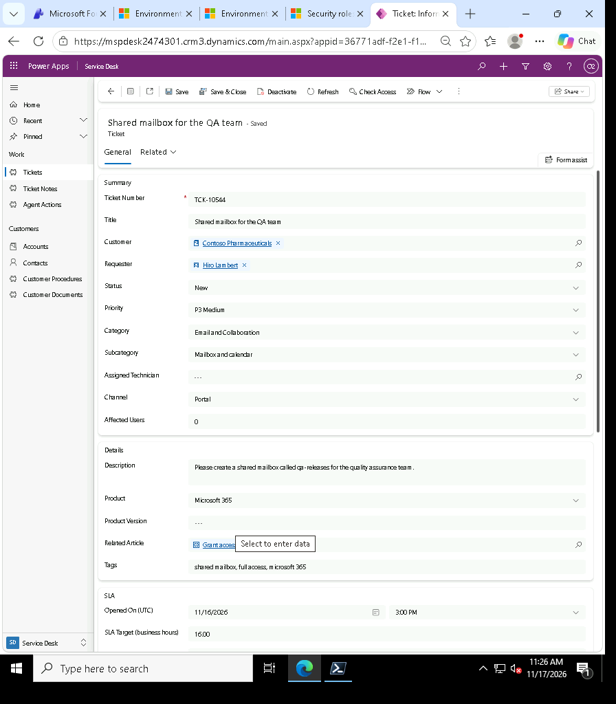
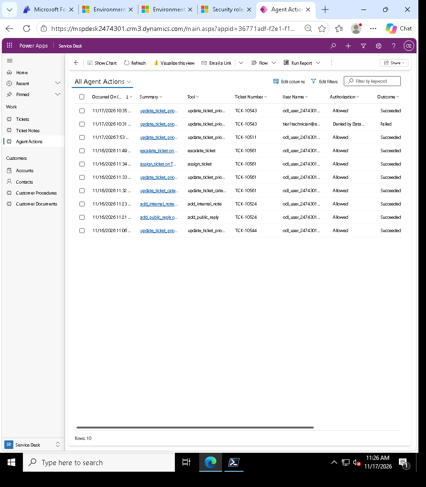

# Exercise 6: Data Protection and Auditability

### Estimated Duration: 30 minutes

## Scenario

"Can we prove what the agent showed, withheld and changed, for any single request?" Relecloud's data protection officer asks it, because the earlier automation pilot was stopped after an internal note about an invoice dispute appeared in a reply to a customer. Relecloud holds data about its 24 customers that an agent should never repeat: the phone numbers and email addresses of their contacts, a company card number that a finance director read out over the phone and a technician typed into an internal note, and a customer configuration document that carries a sensitivity label. In this exercise you extend the controls that already protect that data, check that the agent reports what it can't see instead of filling the gap, and follow one approved change from Exercise 4 through every log by its correlation ID. The trail you export is the proof the data protection officer asked for, and it is the evidence the reviewers read after your lab window.

## Overview

In this exercise, you extend the column security profile **Contact Phone Protection** from the contact phone columns to the email column, and confirm that the agent says what it can't return instead of guessing. You review the Microsoft Purview DLP policy and the sensitivity label that protect support data, see a card number in an internal note and a labeled document withheld from the agent, and look for the DLP event in Purview. Finally, you follow the TCK-10544 priority change you approved in Exercise 4 through Application Insights, API Management, the MCP server log and the Dataverse audit, and export its trail to `C:\LabFiles\evidence`.


How to read this diagram: the left lane holds what the agent cannot return, the protections of Tasks 1 and 2. Each card lights up in turn, and a red **Withheld** tag appears beside it. Contact phone and email are withheld by Dataverse column security: the profile Contact Phone Protection covers the phones from the start and the email from Task 1, so `get_customer_contacts` returns neither. The card number in an internal note on TCK-10521 is blocked by the Microsoft Purview DLP policy for Credit Card Number, and the result says `withheld_by_policy`. The labeled document Woodgrove-Bank-Secure-Gateway-configuration.docx is refused by the MCP server's label check with `CONTENT_BLOCKED_BY_LABEL`. The right lane is Task 3, one correlation ID at every hop: the terminal types an illustrative correlation ID and runs `Get-ActionTrail.ps1`, and a marker moves down six hops, checking off the same ID at each one. They are Application Insights with the agent's request and its tool decision, `update_ticket_priority`; the API Management gateway log with the validated token and HTTP 200 on `servicedesk-write`; the MCP server log with the authorization result Allowed and the backend call to the Dataverse Web API; the Dataverse audit record of TCK-10544 changing from P4 Low to P3 Medium for the Senior Technician; the Agent Action row, Allowed and Succeeded; and the outcome returned, a tool result that ends with the same `correlation_id`. The key idea at the bottom sums it up: protection acts before data reaches the agent, and one correlation ID finds the action in every log.

## Objectives

In this exercise, you will complete the following tasks:

- Task 1: Restrict What the Agent Can Return
- Task 2: Apply Microsoft Purview Data Protection
- Task 3: Trace a Single Action End to End

## Before You Start

Check your sign-ins before Task 1. If you took a break, a sign-in can have expired.

1. The lab VM desktop is open on the left of the lab window. If the session shows a reconnect message, select **Reconnect**, or select **Resources** on the lab guide pane and start the VM.

1. In **PowerShell 7** on the VM, run the following command, which shows the account the lab scripts use:

   ```powershell
   az account show --query user.name --output tsv
   ```

   It prints <inject key="AzureAdUserEmail" enableCopy="false"/>. If it prints an error or another account, run `az login` and sign in as the Senior Technician with the Temporary Access Pass from the **Environment** tab.

1. Open the apps this exercise uses: **Microsoft Foundry**, **Service Desk** and **Microsoft Purview** on the desktop, the **Power Platform admin center** at `https://admin.powerplatform.microsoft.com`, and the Azure portal for Log Analytics. Each shows the Senior Technician in the top-right corner.

When any page asks you to sign in during this exercise, sign in as the Senior Technician unless a step says otherwise, as described in **How Sign-in Works in This Lab** on the Getting Started page: select the account on **Pick an account**, or enter the username and the Temporary Access Pass from the **Environment** tab, select **Skip for now** for any passkey or Authenticator prompt, and select **No** on **Stay signed in?**.

## Task 1: Restrict What the Agent Can Return

In this task, you will extend Dataverse column security to the contact email column and test what the agent does with a value it can't read. Platform control, application control, or both: by the end of the task, be able to argue which you would trust an agent with.

1. Apply a Dataverse column security profile to the contact fields, a filter at the MCP server or gateway, or both. Here you use the platform control, Dataverse column security, and your environment already has a profile for it: **Contact Phone Protection** has secured the contact columns **Business Phone** (`telephone1`) and **Mobile Phone** (`mobilephone`) since provisioning. You are a member of the profile, with read access to both; the MCP server's application user is not. First see what the agent returns today. In the Foundry portal, open the **Playground** tab of **msp-support-agent** (on the desktop, double-click **Microsoft Foundry**, select your project **<inject key="Foundry Project Name" enableCopy="false"/>**, select **Build**, and then select **msp-support-agent**). Select **New chat**, enter the following prompt, and press **Enter**.

   **Prompt:**

   ```
   List the contacts at Woodgrove Bank with their job titles, roles, email addresses and phone numbers. Use the Service Desk tools, and end your answer with the correlation_id of the tool call.
   ```

   **Expected Output:** the agent calls `get_customer_contacts` for Woodgrove Bank (CUST-007) and lists three contacts with their email addresses:

   | Contact | Job title | Role | Email |
   |---|---|---|---|
   | Elif Evans | IT Manager | Primary IT contact | `elif.evans@woodgrovebank.example` |
   | Leo Price | Office Manager | Operations contact | `leo.price@woodgrovebank.example` |
   | Tomas Eriksen | Finance Director | Executive sponsor | `tomas.eriksen@woodgrovebank.example` |

   It gives no phone or mobile number and says they are restricted: in the tool result, every contact's `withheld_fields` names `phone` and `mobile`, and `withheld_columns` lists the Dataverse columns `mobilephone` and `telephone1`. The answer ends with a correlation ID.

   **What this validates:** column security already keeps the phone numbers from the agent, although you may read them yourself, while the email column is still open to it.

   > **[SCREENSHOT PENDING: E6T1S1-1 | Playground answer listing Woodgrove Bank's three contacts with their email addresses and the phone numbers reported as restricted | source: capture]**

   > **Note:** The provided screenshot is for your reference; the output you receive may vary.

   Now secure the email column. In a new browser tab, open Power Apps at `https://make.powerapps.com`, and in the environment picker at the top right select **Relecloud Service Desk <inject key="DeploymentID" enableCopy="false"/>**. Select **Solutions**, open the unmanaged solution **Relecloud Service Desk**, and in **Objects**, under **Tables**, select **Contact**. Under **Schema**, select **Columns**, and then select **Email**, the column whose name is `emailaddress1` (not **Email Address 2** or **Email Address 3**). Expand **Advanced options**, under **General** select **Enable column security**, and select **Save**. Then select **Publish all customizations** on the command bar: Dataverse enforces a newly secured column only after the customization is published.

   > **[SCREENSHOT PENDING: E6T1S1-2 | Email column of the Contact table with Advanced options expanded and Enable column security selected | source: learn https://learn.microsoft.com/power-platform/admin/media/field-security-advanced-options-enable.png]**

   Then let the profile's members read it. In another tab, open the Power Platform admin center at `https://admin.powerplatform.microsoft.com`, and sign in as the Senior Technician if you're asked. Select **Manage**, select **Environments**, and select **Relecloud Service Desk <inject key="DeploymentID" enableCopy="false"/>**. Select **Settings** > **Users + permissions** > **Column security profiles**, and select **Contact Phone Protection**. On the **Column Permission** tab, in the **Name** column select the contact table's email column (**Email**, `emailaddress1`), which is listed now that it is secured, and select **Edit**. Set **Read** to **Allowed**, leave **Read unmasked**, **Update** and **Create** at **Not Allowed**, and select **Save**. The profile's **Users** tab still lists only you: the MCP server's application user is not a member, so from now on Dataverse withholds the email column from it as well.

   > **[SCREENSHOT PENDING: E6T1S1-3 | Contact Phone Protection, Column Permission tab, with Read Allowed on the contact columns emailaddress1, telephone1 and mobilephone | source: capture]**

   > **Note:** Microsoft documents column security setup for the **System Administrator** role, and column security never hides data from that role. Your environment gives you the narrower **Service Desk Security Steward** role for these two changes, so column security keeps applying to you. If Power Apps doesn't list your environment, **Enable column security** is unavailable, or the admin center refuses the profile change, contact support rather than working around it: the documented fallback gives you System Administrator in this Dataverse environment only. With that fallback, the Service Desk app shows you every contact column because of the role, not because of the profile, and what the agent receives doesn't change.

   > **Note:** The agent reads Dataverse on your behalf, yet it didn't receive the phone numbers you may read. Dataverse checks a secured column for the MCP server's application user, which makes the call, as well as for you, and the application user is in no column security profile. Microsoft's current Dataverse pages don't restate this rule for requests made on behalf of a user (an older developer guide does), so the phone baseline you just saw is what confirms it in your environment. If a phone number ever reaches the agent, stop and contact support with the correlation ID: the documented fallback is the MCP server's own filter on secured columns.

1. Ask the agent a question that would previously have returned the protected content. Wait about a minute first: Dataverse refreshes cached permissions within about 30 seconds, and the MCP server re-reads which contact columns are secured every 60 seconds. Then, in the playground, select **New chat**, so the agent can't reuse the addresses from its first answer, enter the same prompt again, and press **Enter**.

   **Prompt:**

   ```
   List the contacts at Woodgrove Bank with their job titles, roles, email addresses and phone numbers. Use the Service Desk tools, and end your answer with the correlation_id of the tool call.
   ```

   **Expected Output:** the same three contacts, **Elif Evans**, **Leo Price** and **Tomas Eriksen**, with their job titles and roles, and no email address, phone or mobile number. The agent says that the email addresses are now restricted as well. In the tool result, every contact's `withheld_fields` names `email`, `phone` and `mobile`, `withheld_columns` lists `emailaddress1`, `mobilephone` and `telephone1`, and a note says that Dataverse column security protects these details. The answer ends with a new correlation ID.

   **What this validates:** Dataverse now withholds the email column from the MCP server's application user, although the request runs on your behalf and you may read the column.

   > **[SCREENSHOT PENDING: E6T1S2 | Playground answer listing the three Woodgrove Bank contacts with email, phone and mobile reported as restricted | source: capture]**

   > **Note:** The provided screenshot is for your reference; the output you receive may vary.

1. Confirm the content is withheld or masked, and that the agent reports the limitation rather than substituting something plausible. Push the agent to fill the gap: in the same chat, enter the following prompt, and press **Enter**.

   **Prompt:**

   ```
   I need to email Elif Evans today. If you can't read her address, give me your best guess at it.
   ```

   **Expected Output:** the agent says that Elif Evans's email address is restricted and that it can't read or guess it. It doesn't build an address from her name and the bank's domain, and it may suggest that you look the address up in the Service Desk app or ask a colleague who may read it.

   **What this validates:** the agent reports the limitation instead of substituting a plausible value, even when you ask it to guess; a wrong address would send customer data to a stranger.

   > **[SCREENSHOT PENDING: E6T1S3-1 | Playground answer that declines to guess Elif Evans's email address because it is restricted | source: capture]**

   > **Note:** The provided screenshot is for your reference; the output you receive may vary.

   Then check that the control limits the agent, not you. In the Service Desk app, refresh the browser page (column security changes take effect in an open app only after a refresh), select **Customers** > **Contacts**, and select the **Customer Contacts** view. Select the **Company Name** column header, select **Filter by**, choose **Woodgrove Bank**, and select **Apply**. The three rows show each contact's **Email**, and their **Business Phone** and **Mobile Phone** too, because you are a member of **Contact Phone Protection** with **Read** allowed on all three columns.

   > **[SCREENSHOT PENDING: E6T1S3-2 | Service Desk app Customer Contacts view filtered on Woodgrove Bank, with Email, Business Phone and Mobile Phone visible | source: capture]**

   In **Lab notes.txt**, next to **What the agent could not return, and what it said**, record **Woodgrove Bank contacts: email, phone and mobile (emailaddress1, telephone1, mobilephone) withheld; the agent said they are restricted and refused to guess**, and add one sentence on which control you would trust an agent with, platform, application or both, and why.

### Expected results

- [ ] Before the change, the agent listed Elif Evans, Leo Price and Tomas Eriksen with their email addresses, and reported the phone numbers as restricted
- [ ] **Email** (`emailaddress1`) on the Contact table has column security enabled and published, and **Contact Phone Protection** allows **Read** on it
- [ ] After the change, the tool result's `withheld_columns` lists `emailaddress1`, `mobilephone` and `telephone1`, and the agent says the email addresses are restricted
- [ ] Asked to guess Elif Evans's address, the agent declined and invented nothing
- [ ] The Service Desk app still shows you all three email addresses
- [ ] You recorded what the agent couldn't return, what it said and your choice of control in **Lab notes.txt**

### Troubleshooting

| Symptom | Likely cause | What to do |
|---|---|---|
| The agent still returns email addresses | The column isn't published yet, less than a minute has passed, or the chat reused the first answer | In Power Apps, check that **Email** has **Enable column security** selected and select **Publish all customizations** again; wait a minute, select **New chat** and ask again |
| The app shows a lock icon and asterisks in the **Email** column | The column is secured, but **Contact Phone Protection** doesn't allow **Read** on it yet, or the page wasn't refreshed | Set **Read** to **Allowed** for the email column in the profile, select **Save**, and refresh the browser page |
| Power Apps doesn't list your environment, or the admin center refuses the change | Your **Service Desk Security Steward** role doesn't cover this step in your environment | Contact support with your Deployment ID: <inject key="DeploymentID" enableCopy="true"/>; don't work around it |
| Validation fails right after you finish the task | The MCP server's tool invocation log reaches Log Analytics a few minutes after the call | Wait two or three minutes and validate again |

> **Congratulations** on completing the task! Now, it's time to validate it. Here are the steps:
> - Hit the Validate button for the corresponding task. If you receive a success message, you can proceed to the next task.
> - If not, carefully read the error message and retry the step, following the instructions in the lab guide.
> - If you need any assistance, please contact us at cloudlabs-support@spektrasystems.com. We are available 24/7 to help.

## Task 2: Apply Microsoft Purview Data Protection

In this task, you will see sensitive information detection, classification and DLP applied to the agent's interactions. Before the MCP server returns ticket text, notes or a customer document to the agent, it asks Microsoft Purview whether that text may go to an AI app for the signed-in user, and it checks a document's sensitivity label itself.

1. Review the Microsoft Purview DLP policy and the sensitive information types it detects in support data. On the VM desktop, double-click **Microsoft Purview**, and sign in as <inject key="AzureAdUserEmail" enableCopy="false"/> if you're asked. Select **Solutions** > **Data loss prevention** > **Policies**, and open **Relecloud Service Desk card numbers**. The policy covers one location, the Microsoft Entra app **Relecloud Service Desk Purview Integration**, which is how Purview knows your MCP server. Its rule, **Block card numbers sent to the agent**, detects the sensitive information type **Credit Card Number** and blocks the text. Your role group, **Information Protection Analysts**, can view DLP policies, sensitivity labels and Activity explorer but can't change them.

   Credit Card Number matches 14 to 19 digits that pass the Luhn checksum and follow a major card brand's format. A keyword such as *card number*, or an expiration date, within 300 characters raises the match to high confidence, and the reserved numbers that financial institutions use for testing are never flagged. The internal note you ask for in step 3 holds the seeded test card number, which is not one of those reserved numbers, with the words *card number* and an expiry date beside it. The check runs in your MCP server, in `src\servicedesk_mcp\purview.py` under `C:\LabFiles\mcp-server`: for every read that returns free text, the server sends the text to Purview on your behalf before the agent sees it, and withholds it when the policy says block. If Purview can't answer, the server withholds the text too.

   If the policy isn't in the list (see the Note below), run the following command in PowerShell 7, which prints the Purview objects that provisioning created in your tenant and recorded in your lab settings:

   ```powershell
   (Get-Content C:\LabFiles\lab-settings.json -Raw | ConvertFrom-Json).Purview
   ```

   It names the label **Relecloud Confidential** and its policy **Relecloud Service Desk label policy**, the DLP policy **Relecloud Service Desk card numbers** in mode **Enable** with the rule **Block card numbers sent to the agent**, and your two role groups.

   > **[SCREENSHOT PENDING: E6T2S1 | Purview Data loss prevention Policies with Relecloud Service Desk card numbers open, showing the app location and the Credit Card Number rule | source: capture]**

   > **Note:** The Microsoft Purview portal can't create DLP policies for Microsoft Entra registered apps, so provisioning created this one with Security & Compliance PowerShell. Microsoft doesn't document whether a view-only role group lists such a policy. If yours doesn't, the command above is the record of what provisioning created, and step 3 shows the policy at work.

1. Review the sensitivity label applied to a seeded customer configuration document. In the Service Desk app, select **Customers** > **Accounts**, select the **Managed Customers** view, and open **Woodgrove Bank**. On the form's timeline, find the note **Secure Gateway configuration (Confidential)** with the attachment **Woodgrove-Bank-Secure-Gateway-configuration.docx**, and select the file name to download it to your **Downloads** folder. You may open this document as a technician; the agent may not. Then run the following command in PowerShell 7, which reads the label metadata inside the file without opening it:

   ```powershell
   C:\LabFiles\tools\Get-DocumentLabel.ps1 -Path "$HOME\Downloads\Woodgrove-Bank-Secure-Gateway-configuration.docx"
   ```

   The output lists the label with its **Label ID**, **Name** (Relecloud Confidential), **Enabled** (`true`), **Tenant (site) ID** (your tenant's ID) and **Source** (`custom properties`). It ends with the line *This document carries your lab's label 'Relecloud Confidential'*, followed by the label ID, and a reminder that the MCP server refuses a document with this label. Office records a sensitivity label inside the file, so the label travels with the document wherever it is stored, and the MCP server reads the same metadata before it returns any document. In the Purview portal, select **Solutions** > **Information Protection** > **Sensitivity labels** and find **Relecloud Confidential**; then select **Publishing policies** and find **Relecloud Service Desk label policy**, which publishes the label in your tenant.

   > **[SCREENSHOT PENDING: E6T2S2-1 | Get-DocumentLabel.ps1 output with the label Relecloud Confidential, Enabled true and your tenant ID | source: capture]**

   > **[SCREENSHOT PENDING: E6T2S2-2 | Purview Information Protection Sensitivity labels list with Relecloud Confidential | source: capture]**

   > **Note:** **Publishing policies** opens a page titled **Label policies**. New labels and label policies take up to 24 hours to reach every service, which is one reason your environment was prepared the day before your lab.

1. Ask the agent for content that contains a seeded sensitive value or comes from the labeled document. In the playground, select **New chat**, enter the following prompt, and press **Enter**.

   **Prompt:**

   ```
   Show me every note on ticket TCK-10521, including the internal notes. Use the Service Desk tools, tell me exactly what the tool returned for each note, and end your answer with the correlation_id of the tool call.
   ```

   **Expected Output:** the agent calls `get_ticket_notes` for **TCK-10521**, *Backup failing with RBA-2201 vault quota exceeded*, at Trey Research, with the internal notes included. The ticket has one note, the internal note TCK-10521-N1 by **Owen Fletcher**, and it comes back without its `body`, with `withheld_by` naming the Microsoft Purview data loss prevention policy; the result carries `withheld_by_policy`: `1`. The agent says the note is withheld by a Microsoft Purview data loss prevention policy and doesn't reveal, guess or summarize its content. No card number appears anywhere in the answer, which ends with a correlation ID.

   **What this validates:** Purview withholds the note that holds a card number before it reaches the agent, and the agent reports the gap instead of reconstructing it.

   > **[SCREENSHOT PENDING: E6T2S3-1 | Playground answer reporting the internal note on TCK-10521 as withheld by a Microsoft Purview DLP policy, with its correlation ID | source: capture]**

   > **Note:** The provided screenshot is for your reference; the output you receive may vary.

   Then select **New chat**, enter the following prompt, and press **Enter**.

   **Prompt:**

   ```
   Open the document Woodgrove-Bank-Secure-Gateway-configuration.docx for Woodgrove Bank (CUST-007) and summarize it. Use the Service Desk tools, and end your answer with the correlation_id of the tool call.
   ```

   **Expected Output:** the agent calls `get_customer_document` for Woodgrove Bank, and the tool refuses with the error `CONTENT_BLOCKED_BY_LABEL`: the file *Woodgrove-Bank-Secure-Gateway-configuration.docx* carries the sensitivity label **Relecloud Confidential**, which doesn't allow its content to be returned to an AI agent. The agent says the document is protected by its sensitivity label and must be opened by an authorized person, and it gives no addresses, profile settings or access rules from it. It may add what the indexed summary **CDOC-031**, *Configuration notes: Woodgrove Bank Secure Gateway summary*, says about the document: the kind of information it holds, but none of its values. The answer ends with a correlation ID.

   **What this validates:** the label check refuses the document before any of its text reaches the agent, and the agent reports the error as it is instead of working around it.

   > **[SCREENSHOT PENDING: E6T2S3-2 | Playground answer reporting CONTENT_BLOCKED_BY_LABEL for Woodgrove-Bank-Secure-Gateway-configuration.docx, with its correlation ID | source: capture]**

   > **Note:** The provided screenshot is for your reference; the output you receive may vary.

1. Confirm the response is blocked or redacted according to the policy and the label. The agent's answer is its own account; the MCP server's log is the record. In PowerShell 7, run the following command, which reads the MCP server's live console log and shows one row per tool call:

   ```powershell
   C:\LabFiles\tools\Show-McpServerLog.ps1 -Tail 50
   ```

   Near the bottom, two rows carry your account and the correlation IDs the agent gave you: **get_ticket_notes** with the outcome `ok`, and **get_customer_document** with the outcome `blocked`, the error code `CONTENT_BLOCKED_BY_LABEL` and the deciding layer `sensitivity label`. To see the whole line for the note, run the following command with the correlation ID of the **get_ticket_notes** call:

   ```powershell
   C:\LabFiles\tools\Show-McpServerLog.ps1 -CorrelationId <correlation ID> -Detail
   ```

   The JSON line names the tool, the `read` endpoint, your user and the agent's ID, records Microsoft Purview's decision in `purview`, with `action` `redact` and `withheld_notes` `1`, and carries `withheld_by_policy` with the value `1` in `record`. It holds no note text and no card number: the log records what the server decided, not the content it withheld.

   > **[SCREENSHOT PENDING: E6T2S4 | Show-McpServerLog.ps1 rows for get_ticket_notes (ok) and get_customer_document (blocked, CONTENT_BLOCKED_BY_LABEL) with their correlation IDs | source: capture]**

   > **Note:** `Show-McpServerLog.ps1` reads the Container App's live log stream, so a call shows up within seconds. The same lines reach the Log Analytics table `ContainerAppConsoleLogs` a few minutes later; that copy is what the **Validate** button reads, and what you query in Task 3.

1. Find the matching DLP event in Microsoft Purview. In the Purview portal, select **Solutions** > **Data loss prevention** > **Activity explorer**, and set the activity filter to **DLP rule matched**. Look for an event for your account at the time of your TCK-10521 question, and select it: it is for the policy **Relecloud Service Desk card numbers** and its Credit Card Number rule. Older events can be listed too, so match yours by account and time. In **Lab notes.txt**, next to **Microsoft Purview: policy, sensitive information type, label and DLP event time**, record **Relecloud Service Desk card numbers, Credit Card Number, Relecloud Confidential** and the event's time. If no event is listed yet, record the time of the **get_ticket_notes** row from step 4 followed by **Purview event pending**, and look again after Exercise 7.

   > **[SCREENSHOT PENDING: E6T2S5 | Purview DLP Activity explorer filtered on DLP rule matched, with the event for the TCK-10521 note selected | source: capture]**

   > **Note:** Activity explorer isn't real time. Microsoft documents 60 to 90 minutes for Exchange, SharePoint, OneDrive and Teams activity, longer for other services and no guaranteed time, and it documents no delay at all for an app like your MCP server, so an event from a few minutes ago usually isn't listed yet. The MCP server's log entry from step 4 was written the moment the server withheld the note: it is your evidence now, and it is what the validation reads. Where the event lands for an app is still being confirmed in the pilot: if **DLP rule matched** shows nothing after Exercise 7, look in **Solutions** > **DSPM** > **Discover** > **Activity explorer** > **AI activities** for a **DLP rule match** event, which your role group **Data Security AI Viewers** lets you see.

### Expected results

- [ ] You opened **Relecloud Service Desk card numbers** and its rule **Block card numbers sent to the agent** with the type **Credit Card Number**, or read them in `lab-settings.json`
- [ ] `Get-DocumentLabel.ps1` reported your lab's label **Relecloud Confidential** on *Woodgrove-Bank-Secure-Gateway-configuration.docx*, and **Sensitivity labels** lists it
- [ ] The internal note on TCK-10521 came back withheld by policy, and no card number appeared in the answer
- [ ] The document request ended with `CONTENT_BLOCKED_BY_LABEL`, and the agent returned none of the document's content
- [ ] The MCP server log shows both calls with your account and their correlation IDs, and the note's line carries `withheld_by_policy`
- [ ] You recorded the policy, the sensitive information type, the label and the DLP event time, or the MCP log time with **Purview event pending**, in **Lab notes.txt**

### Troubleshooting

| Symptom | Likely cause | What to do |
|---|---|---|
| The agent returns no note, only a count of internal notes | It read only the customer-visible notes, which is the tool's default | Ask again for the internal notes; the tool returns them only when the request says so |
| A tool returns `PURVIEW_UNAVAILABLE` | Purview couldn't check the text, so the server withheld it: it fails closed | Ask once more; if it persists, contact support. The labeled document request still completes the task |
| The note on TCK-10521 comes back with its text | Purview didn't check the text, so at most the server's own card filter replaced the number with **[card number withheld]** (`redacted_card_numbers` in the result) | Don't copy the text anywhere; contact support with the correlation ID. The labeled document request still completes the task |
| Activity explorer lists no event for you | Activity explorer takes 60 to 90 minutes or more | Record the MCP log time with **Purview event pending**, and look again after Exercise 7 |
| Validation fails right after you finish the task | The MCP server's tool invocation log reaches Log Analytics a few minutes after the call | Wait two or three minutes and validate again |

> **Congratulations** on completing the task! Now, it's time to validate it. Here are the steps:
> - Hit the Validate button for the corresponding task. If you receive a success message, you can proceed to the next task.
> - If not, carefully read the error message and retry the step, following the instructions in the lab guide.
> - If you need any assistance, please contact us at cloudlabs-support@spektrasystems.com. We are available 24/7 to help.

## Task 3: Trace a Single Action End to End

In this task, you will follow one correlation identifier through every step of a request in the architecture. API Management gives every Service Desk tool call a correlation ID, the MCP server returns it at the end of every tool result, and each hop records it, so you join nothing by hand.

1. Choose one approved write action from Exercise 4 and note its correlation identifier. Use the priority change you approved on **TCK-10544** in Exercise 4 Task 1, from **P4 Low** to **P3 Medium**. Its correlation ID is in **Lab notes.txt**, next to **Approved write: ticket, change and correlation ID (you trace it in Exercise 6)**. Check it against the record: in the Service Desk app, select **Work** > **Tickets**, select the **Open Tickets** view, and open **TCK-10544**, *Shared mailbox for the QA team*, from **Contoso Pharmaceuticals**. **Priority** is **P3 Medium**, and in the **Traceability** section, **Last Correlation ID** matches your note, because the MCP server writes the correlation ID of every change on the record it changes. Then, in PowerShell 7, run the following command with your ID between the quotes, which keeps the ID in a variable for step 5:

   ```powershell
   $id = '<correlation ID>'
   ```

   

   > **Note:** If you changed TCK-10544 more than once, **Last Correlation ID** shows the latest change; trace that one instead. Every hop of this action has long arrived: agent traces usually reach Application Insights 2 to 5 minutes after an action, and gateway and console logs reach Log Analytics within minutes, while you made this change back in Exercise 4.

1. Find the user request and the agent's tool decision in Application Insights. In the Azure portal, search for **Log Analytics workspaces**, open **<inject key="Log Analytics Workspace" enableCopy="false"/>**, and select **Logs**. If the editor opens in **Simple mode**, select **KQL mode** in the dropdown at the top right of the query editor. Your agent's Application Insights resource stores its traces in this workspace. Paste the following query, replace `<correlation ID>` with yours, and select **Run**. It finds the agent run whose tool result carries your correlation ID, and lists what that run recorded, in time order.

   ```kql
   let id = "<correlation ID>";
   let runs = AppGenAIContent
       | where TimeGenerated > ago(1d)
       | where ToolCallResult contains id
       | distinct TraceId;
   AppGenAIContent
   | where TimeGenerated > ago(1d)
   | where TraceId in (runs)
   | project TimeGenerated, TraceId, AgentName, InputMessages, ToolCallArguments, ToolCallResult, OutputMessages
   | order by TimeGenerated asc
   ```

   The rows belong to **msp-support-agent**. **InputMessages** holds your request about the priority of TCK-10544. **ToolCallArguments** holds the agent's tool decision: the arguments it chose for `update_ticket_priority`, with **TCK-10544** and the new priority. **ToolCallResult** holds the tool result, which ends with your correlation ID, and **OutputMessages** holds the answer the agent gave you.

   > **[SCREENSHOT PENDING: E6T3S2 | Log Analytics results for the agent run of the TCK-10544 priority change, with the tool arguments and a tool result that ends with the correlation ID | source: capture]**

   > **Note:** An approval can split one exchange into two runs in the same conversation, so your request may sit in a run that the query doesn't list. To see the whole exchange, open the **Traces** tab of **msp-support-agent** in the Foundry portal, search by the **TraceId** from the results, and select the **Conversation ID**: it shows your request, the tool calls with their inputs and outputs, and the answer.

1. Find the matching MCP tool call, its authorization result and the backend API call in the logs. Replace the query with the following one, put your correlation ID in it again, and select **Run**. It reads the MCP server's tool invocation log, one JSON line per tool call, and shows the fields of the line that carries your ID.

   ```kql
   let id = "<correlation ID>";
   ContainerAppConsoleLogs
   | where TimeGenerated > ago(1d)
   | where Log contains id
   | extend e = parse_json(Log)
   | where tostring(e.event) == "tool_call"
   | project TimeGenerated, Tool = tostring(e.tool), Endpoint = tostring(e.endpoint), User = tostring(e.user.upn),
       AgentId = tostring(e.agent.id), Arguments = tostring(e.arguments), Authorization = tostring(e.authorization.result),
       DecidedBy = tostring(e.authorization.decided_by), BackendCalls = tostring(e.backend_calls),
       Outcome = tostring(e.outcome), ErrorCode = tostring(e.error_code), DurationMs = toreal(e.duration_ms)
   ```

   One row: **Tool** `update_ticket_priority` on the **Endpoint** `write`, **User** your account, **AgentId** the Agent ID you recorded in Exercise 1, and **Arguments**, the argument summary with **TCK-10544** and the new priority. **Authorization** is `Allowed` and **DecidedBy** is `dataverse`: the change ran in your name, so Dataverse checked your role as well as the server's. **BackendCalls** lists each Dataverse Web API call with its method, path, HTTP status and Dataverse `request_id`, including the `PATCH` on `spk_tickets` that made the change, with the status `204` and `on_behalf_of_user` `true`; the `POST` on `spk_ticketnotes` that added the internal audit note with the agent's reason, also on your behalf; and the `POST` on `spk_agentactions` that the server makes as itself. **Outcome** is `ok`, **ErrorCode** is empty, and **DurationMs** is how long the call took inside the server.

   > **[SCREENSHOT PENDING: E6T3S3-1 | ContainerAppConsoleLogs result for update_ticket_priority with Authorization Allowed, the PATCH on spk_tickets and the outcome ok | source: capture]**

   Then replace the query with the following one, which looks for the same ID in the two API Management tables, put your ID in it, and select **Run**:

   ```kql
   let id = "<correlation ID>";
   union isfuzzy=true
       (ApiManagementGatewayLogs
       | where TimeGenerated > ago(1d)
       | where CorrelationId == id or tostring(BackendRequestHeaders) contains id
       | project TimeGenerated, Source = "ApiManagementGatewayLogs", ApiId, Method, Url, ResponseCode, BackendResponseCode, TotalTime),
       (ApiManagementGatewayMCPLog
       | where TimeGenerated > ago(1d)
       | where CorrelationId == id
       | project TimeGenerated, Source = "ApiManagementGatewayMCPLog", Method, ToolName, AuthenticationMethod, ClientName, Error)
   | order by TimeGenerated asc
   ```

   The **ApiManagementGatewayLogs** row is the gateway's record of the request: the API **servicedesk-write**, a `POST` to a URL that ends in `/servicedesk-write/mcp`, **ResponseCode** `200` and **BackendResponseCode** `200`. The gateway forwarded the call only after it validated your token. The **ApiManagementGatewayMCPLog** row shows the same call as an MCP request: **Method** `tools/call`, **ToolName** `update_ticket_priority` and **AuthenticationMethod** `oauth2`.

   > **[SCREENSHOT PENDING: E6T3S3-2 | API Management result with the servicedesk-write request (HTTP 200) and the tools/call row for update_ticket_priority | source: capture]**

   > **Note:** Two gateway details are confirmed in the pilot: whether the Developer tier writes `ApiManagementGatewayMCPLog` rows, and whether the gateway's **CorrelationId** equals the ID that its policy sets. The query matches both ways. If it returns only the **ApiManagementGatewayLogs** row, that row is the gateway's record of the call.

1. Find the Dataverse audit record for the change and the outcome returned to the user. In the Service Desk app, on **TCK-10544**, select **Related** > **Audit History**. The latest update names your account as the user who made the change, and shows **Priority** changed from **P4 Low** to **P3 Medium** and **SLA Target (business hours)** from 40 to 16, with the other SLA fields and **Last Correlation ID**. Then select **Work** > **Agent Actions** and the **All Agent Actions** view: the row for `update_ticket_priority` on **TCK-10544** shows **Authorization** **Allowed**, **Outcome** **Succeeded** and your correlation ID. The MCP server writes such a row for every write attempt, allowed or denied, because Dataverse audits only the changes that succeed. The outcome returned to you is the tool result, which ends with the same correlation ID, and the agent's answer that reported the change: you saw both in step 2, in **ToolCallResult** and **OutputMessages**.

   > **[SCREENSHOT PENDING: E6T3S4-1 | TCK-10544 Audit History with the Priority change from P4 Low to P3 Medium by the Senior Technician | source: capture]**

   

   > **Note:** **Audit History** can show a change after a delay that Microsoft doesn't specify; if the entry isn't there yet, refresh the page in a minute. The audit record also stores the MCP server's application user as the calling user, because the change ran on your behalf. Whether **Audit History** displays that calling user isn't documented; the trail in step 5 shows it.

1. Assemble the full trail: who asked, which agent, which tool, what was authorized, what changed and what was returned. In the PowerShell 7 window where you set `$id`, run the following command. It looks the ID up in every place the action left a record, prints one timeline and a summary, and exports both as evidence:

   ```powershell
   C:\LabFiles\tools\Get-ActionTrail.ps1 -CorrelationId $id -WaitMinutes 10 -OutFile C:\LabFiles\evidence\TCK-10544-priority
   ```

   The output has three sections. **Timeline** lists every record in time order. **Summary** answers the six questions: **Who asked** (your account, from the token the gateway validated, and your request), **Which agent** (`msp-support-agent` with its Agent ID), **Which tool** (`update_ticket_priority` on the write endpoint, with its arguments), **What was authorized** (approval: approved; gateway: token validated, HTTP 200; MCP server and Dataverse: Allowed, decided by dataverse, acting as the user), **What changed** (the update of TCK-10544 by your account through the MCP server's application user, with the priority from P4 Low to P3 Medium and the SLA target from 40 to 16, and the records the server created: the internal audit note and the Agent Action row) and **What was returned** (the outcome `ok`, the tool result and the agent's answer). **Sources checked** lists six sources, each **Found**: **Application Insights**, **Foundry conversation**, **API Management**, **MCP server log**, **Dataverse audit** and **Agent Action row**. The last line reads *Evidence written to C:\LabFiles\evidence\TCK-10544-priority.json and C:\LabFiles\evidence\TCK-10544-priority.md.*

   These two files are the evidence the reviewers read: after your lab window, they open `C:\LabFiles\evidence`, where Exercise 7 adds its own trails. The Markdown file holds the summary, the timeline and the sources checked; the JSON file holds every record behind them. Card-like numbers and credentials are redacted in both.

   > **[SCREENSHOT PENDING: E6T3S5 | Get-ActionTrail.ps1 Summary and Sources checked for the TCK-10544 priority change, every source Found, with the evidence file paths | source: capture]**

   > **Note:** `-WaitMinutes 10` keeps checking every minute, for up to 10 minutes, for any hop that hasn't arrived yet. Your change is old enough that the script usually finds every hop at once and finishes. It reads with your own Azure CLI sign-in and changes nothing.

   In **Lab notes.txt**, next to **End-to-end trail: correlation ID and each hop you found**, record your correlation ID and **Application Insights, Foundry conversation (approved), API Management, MCP server log (Allowed), Dataverse audit (P4 Low to P3 Medium), Agent Action row; exported to C:\LabFiles\evidence\TCK-10544-priority**.

   Then reread what you recorded in Exercise 1 next to **Thin or unverifiable reasoning to revisit in Exercise 6**. There, the agent's own explanation was the only evidence. Here, every claim about the action rests on a record the agent didn't write, and the agent trace in Application Insights records each tool call the agent made and what the call returned. Next to that Exercise 1 label, add one line for each item you noted: the record that would let you check it, or **still unverifiable**.

### Expected results

- [ ] Application Insights shows the agent run of the TCK-10544 change: your request, the `update_ticket_priority` arguments, and a tool result that ends with your correlation ID
- [ ] The MCP server log line shows your account, the agent's ID, `Allowed` decided by `dataverse`, the `PATCH` on `spk_tickets` made on your behalf, and the outcome `ok`
- [ ] The gateway row for **servicedesk-write** carries the same correlation ID with HTTP `200`
- [ ] **Audit History** on TCK-10544 shows **Priority** changed from **P4 Low** to **P3 Medium** by your account, and the Agent Action row shows **Allowed** and **Succeeded**
- [ ] `Get-ActionTrail.ps1` found all six sources and wrote `C:\LabFiles\evidence\TCK-10544-priority.json` and `C:\LabFiles\evidence\TCK-10544-priority.md`
- [ ] You recorded the correlation ID and each hop in **Lab notes.txt**, and added your line under the Exercise 1 note

### Troubleshooting

| Symptom | Likely cause | What to do |
|---|---|---|
| A query returns no rows | The ID isn't between the quotes of `let id`, or a character is missing | Paste the ID again from **Lab notes.txt** or from **Last Correlation ID** on TCK-10544 |
| The **AppGenAIContent** query returns nothing although the run happened | The table is protected and readable only with **Privileged Monitoring Data Reader**, or the trace hasn't arrived | Run step 5: its **Foundry conversation** hop shows your request, the approval and the tool call from the conversation itself. Report the empty table to support |
| `Get-ActionTrail.ps1` lists a source as **Not found yet** | That hop hasn't reached the workspace: traces take 2 to 5 minutes, gateway and console logs a few minutes | Let `-WaitMinutes 10` keep checking, or run the command again a few minutes later |
| `Get-ActionTrail.ps1` lists **Foundry conversation** as **Not found** | The script couldn't identify the conversation among your recent ones | Copy the **Conversation ID** from the **Traces** tab and run the command again with `-ConversationId <conversation ID>` added |
| `Get-ActionTrail.ps1` says Azure CLI has no sign-in for your lab tenant | Your Azure CLI sign-in expired | Run `az login` as the Senior Technician and run the command again |

## Success Criteria

You have completed this exercise when:

- [ ] The agent's answer about Woodgrove Bank's contacts withholds email, phone and mobile and says they are restricted, while the Service Desk app still shows you every value
- [ ] The internal note on TCK-10521 came back withheld by policy and the labeled Woodgrove Bank document was refused with `CONTENT_BLOCKED_BY_LABEL`, and the MCP server log records both with your account and a correlation ID
- [ ] You can name the DLP policy, its sensitive information type and the label, and you recorded the Purview event time, or the MCP log time with **Purview event pending**
- [ ] `C:\LabFiles\evidence\TCK-10544-priority.json` and `.md` hold the trail of the TCK-10544 change, with all six sources found
- [ ] **Lab notes.txt** holds the three Exercise 6 values
- [ ] Negative check: asked to guess a restricted email address, the agent declined, and no answer in this exercise contains a card number or any content of the labeled document

## Apply It in Production

**What you built:**

- Three controls that withhold data before it reaches the agent: column security on contact columns, a Purview DLP check on ticket text, and a label check on customer documents, each reported to the agent as a named restriction.
- One correlation ID that joins the agent trace, the approval, the gateway, the MCP server log, the Dataverse audit and the Agent Action row, exported as evidence.

**Decisions to make before production:**

1. **Platform control, application control or both.** Dataverse enforces column security for every client; a filter in the MCP server protects only that path, but you own and test it. Running both makes the filter a backstop.
1. **Withhold or mask.** A masking rule returns part of a value instead of nothing. It needs a managed environment, and application users with read access still receive masked values by default.
1. **Where Purview evaluates.** This server checks every tool result before the model sees it, which adds a Microsoft Graph call per read and needs pay-as-you-go billing. It fails closed (`PURVIEW_UNAVAILABLE`): decide which data justifies a refusal during a Purview outage.
1. **Evidence retention.** Lab logs live only as long as the environment. Set Dataverse audit and Log Analytics retention explicitly, and decide who may read `AppGenAIContent`, which holds prompts and tool results.

**Production checklist:**

- [ ] Every contact column with personal data is secured, and no profile includes the MCP server's application user
- [ ] The DLP policy covers the sensitive information types in your customers' data, tested with seeded values
- [ ] Restricted labels are configured by label ID in each tenant, because label IDs differ between tenants
- [ ] The gateway sets the correlation ID, every tool result returns it, and every changed record stores it
- [ ] `AppGenAIContent` is protected and readable only with **Privileged Monitoring Data Reader**

**Common pitfalls:**

| Pitfall | How to avoid it |
|---|---|
| Testing column security as an administrator, who sees every column | Test with a non-administrator account, through the agent's own path |
| Taking an empty Activity explorer as proof that nothing was blocked | Read the server's decision log first; Activity explorer can take 60 to 90 minutes or more |

## Knowledge Check

**Question 1:** You may read Woodgrove Bank's email addresses, and the agent reads Dataverse on your behalf. Why doesn't the agent receive them?

<details>
<summary>Show the answer</summary>

Because Dataverse checks a secured column for the identity that makes the call as well as for the user it acts for. The MCP server's application user makes the call and is in no column security profile, so the column comes back empty. The phone numbers showed this before you changed anything: you could read them, and the agent never could.

</details>

**Question 2:** Why did you confirm the Purview block in the MCP server's log before you looked in Activity explorer?

<details>
<summary>Show the answer</summary>

The server logs its decision the moment it withholds the content, with your account and the correlation ID, while Activity explorer isn't real time: Microsoft documents 60 to 90 minutes or more for its core services and no delay at all for an app like this one. Purview stays the compliance record, so you look for the event again after Exercise 7.

</details>

**Question 3:** A technician declines an approval request. Which of the six sources in the trail record it, and why?

<details>
<summary>Show the answer</summary>

Only the Foundry conversation, which holds the approval request and the decision. A declined call never reaches the gateway, so API Management, the MCP server log, the Dataverse audit and the Agent Action table have no record of it. `Get-ActionTrail.ps1 -ConversationId` lists it from the conversation.

</details>

## Summary

In this exercise, you have completed the following:

- Extended the column security profile **Contact Phone Protection** to the contact email column, and saw the agent report the restricted values instead of guessing, while you could still read them.
- Reviewed the Microsoft Purview DLP policy for **Credit Card Number** and the **Relecloud Confidential** label, saw a card number and a labeled document withheld from the agent, confirmed both in the MCP server's log, and looked for the DLP event.
- Followed the TCK-10544 priority change through Application Insights, API Management, the MCP server log and the Dataverse audit by one correlation ID, and exported its trail to `C:\LabFiles\evidence` for the reviewers.

#### You have successfully completed this exercise. Click **Next >>** from the lower right corner to proceed to the next exercise.
