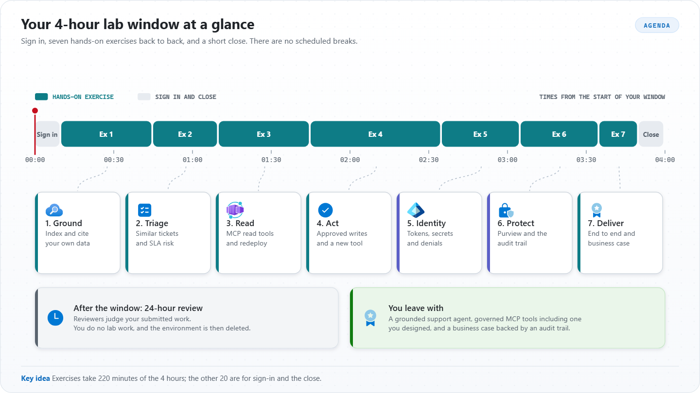

# Agentic MSP Support Agent Guided Lab

### Overall Estimated Duration: 220 minutes

The lab runs in a 4-hour window: 10 minutes to sign in, launch your lab and check readiness, 220 minutes of hands-on exercises, and 10 minutes to close. There are no scheduled breaks.

## Lab Scenario

Relecloud Managed Services runs IT for 24 customers, from Woodgrove Bank and Humongous Insurance to Fabrikam Residences and Tailspin Toys, with 15 technicians in four teams: Service Desk, Infrastructure, Workplace, and Security and Identity. Every incident and request lands in Relecloud's Service Desk app. Last quarter's service review found that technicians spent about a third of their handling time searching 500 past tickets, 120 knowledge articles and 36 customer documents, that new tickets waited in the queue until someone found time to triage them, and that 11 Platinum and Gold SLA breaches cost USD 18,400 in service credits. An earlier automation pilot was stopped after an internal note about an invoice dispute appeared in a reply to a customer.

This morning the queue holds 60 open tickets and 2 new incidents. Five open tickets have no priority or category, and five are within two business hours of their SLA target or already past it. As an engineer on Relecloud's service desk automation team, you build an AI support agent that answers from Relecloud's own Service Desk data, acts on tickets through governed tools on behalf of the technician who asks, and leaves an audit trail that the security team can follow from the answer to the database record. At the end, you present it as something an MSP could deploy for its own customers.

## Lab Overview

In this lab, you will explore how Microsoft Foundry Agent Service, a Model Context Protocol (MCP) server and Microsoft Dataverse work together to give a service desk an agent it can trust. You will ground the agent in Relecloud's own documentation and ticket history, let it read and change tickets through MCP tools behind Azure API Management, and verify that every action runs as the signed-in technician, waits for approval, protects sensitive data and leaves one correlated audit trail.

This lab introduces the foundational concepts of agentic support automation for managed service providers, focusing on grounding, ticket intelligence, MCP tool design, identity and least privilege, data protection, auditability and the business case.

Your lab environment is yours alone and is ready before you start: your own Microsoft Entra tenant and Azure subscription, the Service Desk app with its data, the agent with its baseline MCP tools, the MCP server and the services that protect and log it. Every environment is created from the same template, the **Golden Environment v1.0**, so the expected results in this guide match what you see.



How to read this diagram: the bar across the top is your 4-hour window, measured from the start of your session. The marker moves along it, and the card for each exercise lights up while that exercise runs: ground, triage, read, act, identity, protect and deliver. The two cards at the bottom show what happens after the window, when reviewers judge your submitted work for 24 hours while you do no lab work, and what you leave with.

## Lab Objectives

After completing this lab, you will be able to:

- **Environment readiness and grounding:** Confirm your environment is ready, build a search index over the Service Desk content, and ground a Foundry agent in it so that every answer cites its source.
- **Ticket and incident intelligence:** Use the grounded agent to find similar incidents, summarize a customer's support history, recommend priority, category and assignment, and spot SLA risk in business hours.
- **MCP read tools:** Trace an MCP tool from its catalog entry to its Dataverse Web API query, call it from the agent, test its error handling, and redeploy a change.
- **MCP action tools:** Let the agent change tickets through approval-gated write tools, keep internal notes out of customer replies, chain grounding into action, tighten a tool boundary, and design a new scoped tool.
- **Identity, secrets and authorization:** Map every identity and token in a request, verify secret handling in Azure Key Vault, and show that Dataverse enforces both a least-privilege boundary and the signed-in user's own role.
- **Data protection and auditability:** Restrict what the agent can return with Dataverse column security and Microsoft Purview, and follow one correlation identifier through every log.
- **End-to-end scenario and business case:** Run a new incident from intake to an authorized, audited action, and present what you built as something an MSP could deploy.

## Prerequisites

Before starting the lab, you should have:

- Working knowledge of the Azure portal and resource groups
- Basic PowerShell, and the ability to read Python and JSON
- A general idea of how REST APIs and OAuth tokens work
- Familiarity with service desk concepts such as tickets, priorities and SLAs; Power Apps or Dataverse experience helps but is not required

The following are prerequisites, **already configured in this lab environment**:

- Your own **Microsoft Entra tenant** and **Azure subscription**, with every Azure resource in your resource group (pre-provisioned)
- Two work accounts in your tenant: the **Senior Technician**, which you use for most of the lab, and the **Tier 1 Technician**, which you use once in Exercise 5 (pre-created; their sign-in details are on the **Environment** tab). Neither account holds a tenant administrator role.
- **Microsoft 365 E5** (for Microsoft Purview) and **Power Apps Premium** (for the Service Desk app) on both accounts (pre-assigned)
- A **Power Platform managed developer environment** with the **Service Desk** app, its seeded data and least-privileged security roles (pre-provisioned)
- The Foundry agent **msp-support-agent**, registered with its own **Microsoft Entra Agent ID**, with the baseline Service Desk MCP tools and no knowledge source (pre-created)
- The **MCP server**, release `v3.0.0`, running in your Container App behind Azure API Management, with its source already cloned on your lab VM in `C:\LabFiles\mcp-server` (pre-deployed)
- The Service Desk content exported to Azure Blob Storage, ready for you to index (pre-exported)
- A **Microsoft Purview** data loss prevention policy and a sensitivity label applied to one customer document (pre-configured)

## Architecture

You work from the lab VM in your browser. The agent, `msp-support-agent`, runs in Microsoft Foundry on the `gpt-5.1` model and has its own Microsoft Entra Agent ID. In Exercise 1 you give it a knowledge source: an Azure AI Search index that you build from the Service Desk content provisioning exported to Blob Storage. The agent reads and changes tickets through two MCP tools: `servicedesk-read`, whose tools run without approval, and `servicedesk-write`, whose every call waits for your approval. Both connect through Azure API Management with your own token. API Management validates that token, adds a correlation identifier and the backend key, and forwards the call to the MCP server in Azure Container Apps. The MCP server validates the input, checks the backend key against its own copy, which it reads from Azure Key Vault with its managed identity, and calls the Dataverse Web API on behalf of the signed-in technician, so Dataverse applies that technician's security role as well as the server's own. Microsoft Purview checks ticket text and customer documents before they reach the agent. Agent traces go to Application Insights, and API Management, the MCP server and Key Vault write their logs to the same Log Analytics workspace, so one correlation identifier finds a request at every hop.

## Architecture Diagram


How to read this diagram: everything inside the outer lane belongs to your own Microsoft Entra tenant and Azure subscription. The numbered badges follow one request. In step 1 you send a prompt from the lab VM to `msp-support-agent`. In step 2 the agent grounds its answer on `servicedesk-knowledge`, built from the Blob export. In step 3 the tool call passes API Management, which adds a correlation ID. In step 4 the MCP server validates the call, waits for your approval on writes, and uses the secret it read from Key Vault. In step 5 the Dataverse call runs on behalf of the signed-in user and is audited. In step 6 every hop logs the same correlation ID, which you follow in Exercise 6.

## Explanation of Components

| Component | Description |
|-----------|-------------|
| Microsoft Foundry Agent Service | Hosts `msp-support-agent`, a prompt agent on `gpt-5.1`, with two Service Desk MCP tools. You add its knowledge source in Exercise 1 and test it in the agent playground. |
| Microsoft Entra Agent ID | Gives the agent its own identity in Microsoft Entra ID. The agent holds no permission on Dataverse; the MCP server records its ID in every tool call it logs. |
| Microsoft Entra ID | Holds your two technician accounts, the agent's identity and the gateway app registration whose scope `ServiceDesk.Access` your token carries. |
| MCP server (Azure Container Apps) | The Relecloud Service Desk MCP server, release `v3.0.0`: 16 read tools on its read endpoint and 7 approval-gated write tools on its write endpoint. It is the only code in the lab, and you change it. |
| Azure API Management (Developer tier) | The MCP gateway. Its read and write APIs accept only a signed-in technician's token; a diagnostics API accepts a subscription key so you can call read tools from the lab VM. It logs every call with its correlation identifier. |
| Microsoft Dataverse | The system of record in your Power Platform managed developer environment: tickets and notes, customers with their procedures and documents, contacts, knowledge articles, runbooks, technicians, SLA definitions and the business calendar. |
| Power Apps model-driven app | The **Service Desk** app, built by Spektra for this lab over Dataverse tables whose names start with `spk_`. You use it to check every answer and every change the agent makes. |
| Azure Blob Storage | Holds the export of the Service Desk content, one JSON file per document, that you index in Exercise 1. |
| Azure AI Search | Hosts the `servicedesk-knowledge` index that you create and load. It is the agent's knowledge source. |
| Azure Key Vault | Stores the backend key, `mcp-backend-key`, that API Management sends to the MCP server, so only the gateway can call the server. Both read it through managed identities, and its audit log records every read. |
| Microsoft Purview | Applies data loss prevention and a sensitivity label to what the MCP tools return to the agent. |
| Azure Container Registry | Builds new MCP server images from the source on your lab VM, so you don't need Docker. |
| Azure Monitor (Log Analytics and Application Insights) | Collects agent traces, gateway logs, Key Vault audit logs and the MCP server's tool invocation log. |

# Getting Started with the Lab

Welcome to your Agentic MSP Support Agent lab! We've prepared a seamless environment for you to explore and learn. Let's begin by making the most of this experience.

## Accessing Your Lab Environment

Once you're ready to dive in, your virtual machine and lab guide will be right at your fingertips within your web browser.

> **[SCREENSHOT PENDING: GS1 | Lab environment with the virtual machine on the left and the lab guide on the right | source: reuse]**

## Exploring Your Lab Resources

To view your lab credentials and resource details, navigate to the **Environment** tab.

> **[SCREENSHOT PENDING: GS2 | Environment tab showing the lab credentials and resource details | source: reuse]**

## Utilizing the Split Window Feature

For convenience, you can open the lab guide in a separate window by selecting the **Split Window** button from the top right corner.

> **[SCREENSHOT PENDING: GS3 | Split Window button in the top right corner of the lab guide | source: reuse]**

## Managing Your Virtual Machine

Feel free to **Start**, **Stop**, or **Restart** your virtual machine as needed from the **Resources** tab. Your experience is in your hands!

> **[SCREENSHOT PENDING: GS4 | Resources tab with the virtual machine Start, Stop, and Restart controls | source: reuse]**

> **Note:** If the VM is not in use, please **deallocate** it to avoid unnecessary resource consumption. The Container App, API Management and the other Azure services keep running while the VM is stopped, so your work is not lost.

## Lab Guide Zoom In/Zoom Out

To adjust the zoom level for the environment page, click the **A↕ : 100%** icon located next to the timer in the lab environment.

> **[SCREENSHOT PENDING: GS5 | Zoom control next to the lab timer | source: reuse]**

## Lab Validation

Some tasks in this lab are automatically graded. After completing a task, click the **Validate** button for the corresponding step, inline in the guide or on the **Lab Validation** tab.

1. If you receive a success message, proceed to the next task.
1. If validation fails, hover over the information icon to read the error message, retry the step, and validate again.

> **[SCREENSHOT PENDING: GS6 | Lab Validation tab with the Validate button per step | source: reuse]**

> **Note:** Most checks read the MCP server's tool invocation log, which reaches Log Analytics a few minutes after the action. If a validation fails right after you finish a task, wait two or three minutes and validate again. Tasks without automatic validation have an **Expected results** checklist: compare your results with it before you move on.

## Before You Begin: Browser and Clipboard Tips

> **Note:** Use **Microsoft Edge** or **Google Chrome** for the best experience. Firefox and Safari can show a persistent "Paste" button that interferes with clicks.

> **Note:** When the browser asks for clipboard permission, select **Allow**; the copy buttons in this guide need it. If copy-paste into the VM still fails, use the **VM Native Clipboard** slider in the ellipsis (three-dot) menu, or right-click and copy manually.

> **Note:** If the browser-based VM connection fails, check that your network allows `wss://*.ms-cloudlabs.ai` (minimum 8 Mbps), disable VPN, proxy and ad blockers, or fall back to a native RDP connection using the **LabVM DNS Name**, **LabVM Admin Username** and **LabVM Admin Password** from the **Environment** tab (prefix a local username with `.\`).

> **Note:** Lab emails (invitations, credentials) come from **noreply@cloudlabsai.net**; check your SPAM or JUNK folder and add the sender to your safe senders list.

## Let's Get Started with Azure Portal

1. In the virtual machine, double-click the **Azure Portal** shortcut on the desktop, or browse to the URL below:

   ```
   https://portal.azure.com
   ```

1. On the **Sign into Microsoft** tab, enter the Senior Technician's username, and click **Next**:

   - **Email/Username:** <inject key="AzureAdUserEmail" enableCopy="true"/>

     > **[SCREENSHOT PENDING: GS7 | Sign-in screen with the username field highlighted | source: capture]**

1. Enter the following Temporary Access Pass, and click **Sign in**:

   - **Temporary Access Pass:** <inject key="AzureAdUserPassword" enableCopy="true"/>

     > **[SCREENSHOT PENDING: GS8 | Sign-in screen with the Temporary Access Pass field highlighted | source: capture]**

   > **Note:** The page may say **Enter Temporary Access Pass** or simply **Enter password**. Paste the same value either way. Microsoft requires multifactor authentication for the Azure portal, the Microsoft Entra admin center and changes made through the Azure CLI, and a Temporary Access Pass satisfies that requirement, so you do not need a phone or an authenticator app.

1. If you're asked to set up a passkey or the Microsoft Authenticator app, select **Skip for now**.

   > **Note:** Don't register a personal phone, authenticator app or passkey on the lab accounts. The Temporary Access Pass is all you need.

1. If you see the **Stay signed in?** pop-up, click **No**.

1. If a **Welcome to Microsoft Azure** tour pop-up appears, select **Maybe Later** to skip it.

1. In the search bar at the top of the portal, type **Resource groups**, select **Resource groups**, and then select your resource group:

   ```
   <inject key="Resource Group Name" enableCopy="false"/>
   ```

   > **[SCREENSHOT PENDING: GS9 | Resource groups page with the lab resource group selected | source: capture]**

## Sign In to the Azure CLI

The lab scripts on the VM use your own Azure CLI sign-in. Sign in once now.

1. On the VM, select **Start**, type **PowerShell 7**, and open **PowerShell 7 (x64)**.

1. Run the following command, which opens a sign-in window for the Azure CLI:

   ```powershell
   az login
   ```

1. In the sign-in window, choose **Work or school account** if you're asked, and sign in as the Senior Technician:

   - **Email/Username:** <inject key="AzureAdUserEmail" enableCopy="true"/>
   - **Temporary Access Pass:** <inject key="AzureAdUserPassword" enableCopy="true"/>

   > **Note:** Depending on the Azure CLI version, the sign-in opens as a Windows account window or as a browser tab. Both work. If a command later fails with an error that asks for multifactor authentication, run `az login` again and sign in with the pass.

1. If a **Sign in to all apps and websites on this device?** window appears, select **No, this app only**. Selecting **Yes** registers the lab VM with your tenant, which the lab doesn't need.

1. If the Azure CLI lists subscriptions and asks you to select one, press **Enter** to keep the default.

1. Run the following command, which shows the account the Azure CLI is signed in with:

   ```powershell
   az account show
   ```

   In the output, **user** > **name** is the Senior Technician account.

   > **[SCREENSHOT PENDING: GS10 | PowerShell 7 window showing az account show output with the Senior Technician account | source: capture]**

## Meet Your Lab Environment

1. On the VM desktop, find the shortcuts the environment created for you: **Lab readiness check**, **Service Desk**, **Microsoft Foundry**, **Azure Portal**, **Microsoft Purview**, **Microsoft Entra admin center** and **MCP server (VS Code)**.

1. Double-click **Lab notes.txt** on the desktop and keep it open. The exercises ask you to record values here, such as correlation identifiers and the outcome of each check, and later exercises use them. The last section is the business case you complete in Exercise 7.

   > **[SCREENSHOT PENDING: GS11 | Lab VM desktop with the lab shortcuts and Lab notes.txt | source: capture]**

1. The settings the lab scripts read, such as your resource names and endpoints, are in `C:\LabFiles\lab-settings.json`. You don't need to edit it.

## Working in Your Own Environment

Your environment is dedicated to you: your own tenant, subscription, Dataverse environment, agent and MCP server. Nothing you do reaches another participant. These points keep your lab on track:

- **Keep what you build.** After the 4-hour window, reviewers judge your submitted work in your environment for 24 hours. Don't delete the index, agent versions, tool changes or notes you create.
- **Approve only what you asked for.** Every write tool asks for your approval and shows the tool and its arguments. Read them before you approve.
- **Expect a short delay on logs and traces.** Agent traces reach Application Insights 2 to 5 minutes after a run, and the MCP server and gateway logs reach Log Analytics within a few minutes. Exercise 6 traces an action you took in Exercise 4 so that its data has long arrived.
- **Stop and ask when the environment disagrees with the guide.** If a readiness row shows **Not ready** or a result differs from **Expected results** in a way the Troubleshooting table doesn't cover, contact support rather than working around it.

## Support Contact

The CloudLabs support team is available 24/7, 365 days a year, via email and live chat.

- Email Support: cloudlabs-support@spektrasystems.com
- Live Chat Support: https://cloudlabs.ai/labs-support

When you contact support, include your Deployment ID: <inject key="DeploymentID" enableCopy="true"/>

Now you're all set to explore the powerful world of technology. Learn, experiment, and make the most of your lab experience!

Click **Next** from the bottom-right corner to embark on your lab journey!

### Happy Learning!!
