# Agentic MSP Support Agent Guided Lab

- **Lab Type:** Step-by-step guided lab
- **Audience:** MSP service desk engineers, automation engineers and solution architects
- **Audience Level:** Advanced (L300)
- **Total Duration:** 220 minutes of hands-on labs, delivered in a 4-hour lab window with no scheduled breaks (see [AGENDA.md](AGENDA.md))

## Lab Overview

Relecloud Managed Services, a fictional managed service provider, runs IT for 24 customers with 15 technicians. Last quarter's service review found that technicians spent about a third of their handling time searching 500 past tickets, 120 knowledge articles and 36 customer documents, and that 11 Platinum and Gold SLA breaches cost USD 18,400 in service credits. In this lab you build an AI support agent in Microsoft Foundry that answers from Relecloud's own Service Desk data with citations, triages new incidents, and acts on tickets through governed MCP tools on behalf of the technician who asks, with your approval on every change. You then prove its controls: the identity and token flow, least privilege enforced by Microsoft Dataverse, data protection with column security and Microsoft Purview, and one correlation ID that traces every action from the answer to the database record.

Each participant works alone in a dedicated Microsoft Entra tenant and Azure subscription, built from the same versioned template (Golden Environment v1.0) and safe by default from the first minute: least-privileged identities with read and write separated, the backend credential in Azure Key Vault, approval on every write tool, input validation on every tool, and correlation logging on every request. Participants extend and test controls that already work; no exercise asks them to fix a security exposure.



---

## Delivery Path

**Delivery team: start here.** This README is the front door for everyone who builds, prepares, runs or maintains this lab. Work through the eight phases in order. Every document below opens with the phase it belongs to and ends with a link to the next one.

| Phase | When | What you do | Document | Who |
|---|---|---|---|---|
| **1. Plan the delivery** | On request | Confirm workshop dates, the lab start time and the participant count (up to 25 plus 2 spares per workshop); check licenses and budget; share the agenda | This README ([licenses](#required-licenses-and-entitlements)), [AGENDA.md](AGENDA.md), [estimates/](estimates/) | Delivery lead |
| **2. Build and publish the template** | Once per lab version | Build the lab files zip with the MCP server release, compile and upload the template files, create the Dedicated Tenant template with its user-creation JSON, run one test deployment | [setup/README.md](setup/README.md) | CloudLabs engineer |
| **3. Prepare the environments** | At least 24 hours before each workshop | Deploy every participant environment and the spares, enable Purview pay-as-you-go in each tenant, confirm that provisioning succeeded and every readiness check passes, share the consistency report | [setup/tenant/RUNBOOK.md](setup/tenant/RUNBOOK.md) and [setup/tenant/PURVIEW-RUNBOOK.md](setup/tenant/PURVIEW-RUNBOOK.md) | CloudLabs engineer |
| **4. Register the validation steps** | After phase 2 | Grant the validation service principal its read-only roles, register the 14 graded steps and put their GUIDs into the guide | [validation-scripts/README.md](validation-scripts/README.md) | CloudLabs engineer |
| **5. Run the pilot** | Before the first workshop | Deploy one environment from the template, walk every exercise as a participant, capture screenshots and one GIF per task, settle the open questions, run the acceptance tests | [SUPPORT-GUIDE.md](SUPPORT-GUIDE.md#phase-5-run-the-pilot), [SCREENSHOT-TODO.md](SCREENSHOT-TODO.md), [BUILD-NOTES.md](BUILD-NOTES.md#open-questions-to-settle-in-the-pilot) | Lab author and CloudLabs engineer |
| **6. Support the workshop** | Event day | Final readiness sweep, live support by chat and email, spare swaps within 15 minutes, resets within 60 minutes | [SUPPORT-GUIDE.md](SUPPORT-GUIDE.md#phase-6-support-the-workshop), plus the event-day checks in the runbook | CloudLabs support |
| **7. Close the event** | After the 24-hour review window | Confirm the reviewers are done, let the environments be deleted, verify teardown, reconcile costs | [setup/tenant/RUNBOOK.md](setup/tenant/RUNBOOK.md) | CloudLabs engineer and delivery lead |
| **8. Maintain the lab** | When a product changes | Update steps, diagrams, the MCP server, lab files and estimates | [BUILD-NOTES.md](BUILD-NOTES.md) | Lab author |

### What is automated and what is manual

| Part of the environment | How it is done |
|---|---|
| Each participant's Microsoft Entra tenant, Azure subscription and two accounts | The CloudLabs Dedicated Tenant lab with an Azure subscription: the Senior Technician is the lab user, and the Tier 1 Technician and both accounts' licenses come from `setup/scripts/user-creation.json` |
| Azure resources and the lab VM | Fully automated by the CloudLabs template: `setup/deploy-01.json` (compiled from `setup/bicep/`) and the VM bootstrap `setup/scripts/psscript-01.ps1` |
| Tenant configuration: gateway app, Purview label and DLP policy, Dataverse environment, schema, security roles, seed data, search export, MCP image, agent and its two MCP connections | Scripted provisioning on the lab VM (`C:\LabFiles\provision`), which reports **Succeeded** or **Failed** for every step and finally removes the lab user's Global Administrator role |
| Microsoft Purview pay-as-you-go | Manual portal step in each tenant (no API), in [setup/tenant/PURVIEW-RUNBOOK.md](setup/tenant/PURVIEW-RUNBOOK.md) |
| Lab files on the VM (`C:\LabFiles`) | Built once per lab version by `setup/Build-LabFilesZip.ps1`, which packs the MCP server release `v3.0.0`, then uploaded with the template files |
| Readiness | `Test-LabReadiness.ps1` checks every component against Golden Environment v1.0 and writes the consistency report |
| Grading | 14 validation scripts registered on the template; every other task has an **Expected results** checklist |
| Cleanup | Nothing for participants to delete: the platform deletes each environment when the 24-hour review window ends, and the runbook verifies the teardown |

---

## Prerequisites

### Attendee knowledge

- Working knowledge of the Azure portal and resource groups
- Basic PowerShell, and the ability to read Python and JSON
- A general understanding of REST APIs and OAuth access tokens
- Familiarity with service desk concepts (tickets, priorities, SLAs); Power Apps or Dataverse experience helps but isn't required

### Required licenses and entitlements

| License or entitlement | Entitles in this lab | Scope | Provisioned by |
|---|---|---|---|
| **Microsoft 365 E5** (or Microsoft 365 E3 with Microsoft Purview Suite) | Microsoft Purview DLP and sensitivity labels for the agent's interactions | Per identity: the Senior Technician and the Tier 1 Technician | CloudLabs assigns it from the user-creation JSON (offer ID confirmed with CloudLabs) |
| **Power Apps Premium** (`POWERAPPS_PER_USER`) | Running the Service Desk model-driven app in a managed developer environment | Per identity: both technicians | CloudLabs assigns it from the user-creation JSON (offer ID confirmed with CloudLabs) |
| **Microsoft Purview pay-as-you-go** | Purview data security for the MCP server's Entra-registered app through the `processContent` API, which a DLP block needs | Per tenant, billed to the tenant's Azure subscription | Enabled once in each tenant by the supplier ([PURVIEW-RUNBOOK.md](setup/tenant/PURVIEW-RUNBOOK.md)) |
| **Microsoft Entra ID Free** (included with the tenant) | The two accounts, the gateway and setup app registrations, and the agent's Microsoft Entra Agent ID | Per tenant | The CloudLabs Dedicated Tenant |
| **Azure subscription, consumption billing** | Foundry models (`gpt-5.1` and `text-embedding-3-small`, billed per token, up to 4 million input and 0.4 million output tokens per environment per workshop), Azure AI Search Basic, API Management Developer, Container Apps Consumption, Container Registry Basic, Storage, Key Vault, Log Analytics, Application Insights and the lab VM | One subscription per participant tenant | CloudLabs (see [estimates/](estimates/)) |
| **Foundry Models quota (Global Standard, Canada Central)** | `gpt-5.1`: a 100,000 tokens-per-minute deployment; `text-embedding-3-small`: 150,000 | Per subscription. A Free Tier subscription has no `gpt-5.1` quota; Tier 1 allows 250,000 TPM | CloudLabs checks each subscription's quota tier before provisioning |

Not required: Microsoft Agent 365, Dynamics 365 licenses, and GitHub accounts (the MCP server source is already on the lab VM).

### Environment configuration (pre-provisioned)

- Two accounts in your tenant: the **Senior Technician** (the lab user, which holds no Microsoft Entra directory role when the lab starts) and the **Tier 1 Technician**, which is read-only on tickets
- A **managed developer environment** in Microsoft Dataverse with the **Service Desk** model-driven app and its seeded data: 24 customers, 72 contacts, 63 customer procedures, 36 customer documents, 120 knowledge articles, 12 runbooks, 15 technicians in 4 teams, 16 SLA policies, 500 historical tickets, 60 open tickets plus 2 new incidents that are not in the search export, and 1,436 ticket notes
- Least-privileged Dataverse security roles with read and write separated, the **Relecloud Regulated Accounts** business unit, the column security profile **Contact Phone Protection** on the contact phone columns, and auditing on
- The prompt agent **msp-support-agent** with its own Microsoft Entra Agent ID and two MCP tools, **servicedesk-read** (no approval) and **servicedesk-write** (approval on every call), and no knowledge source until Exercise 1
- A Microsoft Purview sensitivity label on one customer document and a DLP policy that blocks credit card numbers in the MCP server's interactions
- The Service Desk export in Blob storage (753 documents, one JSON file each), ready for you to index

### Azure resources and configuration

The following are deployed in your subscription in **Canada Central** before you start:

- A lab VM (Standard_D2s_v5, Windows) with Microsoft Edge, Visual Studio Code, PowerShell 7, Python 3.12, Azure CLI, Git, the lab tools in `C:\LabFiles`, a **Lab readiness check** shortcut and **Lab notes.txt** on the desktop
- A **Microsoft Foundry** resource and project with the `gpt-5.1` and `text-embedding-3-small` deployments, tracing to Application Insights, and the project connections the agent uses
- **Azure AI Search** Basic, with no index (you build it in Exercise 1)
- **Azure API Management** Developer tier with the `servicedesk-read` and `servicedesk-write` MCP APIs and a diagnostics API for the lab tools
- **Azure Container Apps** running the MCP server release `v3.0.0`, with **Azure Container Registry** for your builds
- **Azure Key Vault** holding the MCP server's backend credential, with its audit log in Log Analytics
- A **storage account** with the Service Desk export
- **Log Analytics** and workspace-based **Application Insights** receiving the agent, gateway, MCP server and Key Vault telemetry

---

## Lab Exercises

### [Exercise 1: Environment Readiness and Grounding the Agent](Instructions/exercise-1.md)

**Estimated Duration: 35 minutes**

Confirm with the readiness check that every component of your environment responds, build an Azure AI Search index over the Service Desk export with the fields a citation needs, and connect it to the agent as its knowledge source. Test simple retrieval, resolve an ambiguous case where two knowledge articles share a symptom but split on the customer's versions, and have the agent explain where each answer came from.

| Task | Topic | Duration |
|------|-------|----------|
| Task 1 | Verify Readiness | 6 min |
| Task 2 | Connect the Agent to the Knowledge Base | 15 min |
| Task 3 | Test Retrieval on Simple Questions | 6 min |
| Task 4 | Resolve an Ambiguous Case | 5 min |
| Task 5 | Explain the Reasoning | 3 min |

### [Exercise 2: Ticket and Incident Intelligence](Instructions/exercise-2.md)

**Estimated Duration: 25 minutes**

Match a new incident that the agent has never seen to its closest historical tickets, summarize a customer's support history and escalations, recommend priority, category and assignment, see the agent ask for the details an incomplete ticket is missing, and find the tickets closest to breaching their SLA in business hours.

| Task | Topic | Duration |
|------|-------|----------|
| Task 1 | Identify Similar Historical Incidents | 7 min |
| Task 2 | Summarize a Customer's Support History | 6 min |
| Task 3 | Recommend Priority, Category and Assignment | 6 min |
| Task 4 | Detect an SLA Risk | 6 min |

### [Exercise 3: Using the MCP Read Tools](Instructions/exercise-3.md)

**Estimated Duration: 35 minutes**

Review the MCP server source already cloned on your lab VM, read its tool catalog with input and output schemas, and trace a tool to its Dataverse Web API query. Call a read tool through the agent and find the call in the tool invocation log by its correlation ID, test structured error handling, and change, build and redeploy your copy of the MCP server with a rollback path.

| Task | Topic | Duration |
|------|-------|----------|
| Task 1 | Review the MCP Server on Your Lab VM | 7 min |
| Task 2 | Call an Existing Read Tool | 6 min |
| Task 3 | Test Tool Error Handling | 7 min |
| Task 4 | Redeploy Your Copy of the MCP Server | 15 min |

### [Exercise 4: Using the MCP Action Tools](Instructions/exercise-4.md)

**Estimated Duration: 50 minutes**

Approve and decline write tool calls in the agent chat, keep an internal note out of a customer-visible reply, chain grounding into an approved action on a new incident, tighten a tool boundary and redeploy, and design, build and add a new scoped write tool that needs approval like every other write.

| Task | Topic | Duration |
|------|-------|----------|
| Task 1 | Call a Write Tool with Approval | 10 min |
| Task 2 | Separate a Public Reply from an Internal Note | 9 min |
| Task 3 | Chain Grounding into Action | 12 min |
| Task 4 | Tighten a Tool Boundary | 8 min |
| Task 5 | Design and Add a Scoped Tool | 11 min |

### [Exercise 5: Identity, Secrets and Authorization](Instructions/exercise-5.md)

**Estimated Duration: 30 minutes**

Map every identity and token in one write request, verify that the backend credential lives only in Key Vault and is read through a managed identity, narrow a least-privilege boundary and capture Dataverse's refusal, and show that the same agent does less for the Tier 1 Technician than for the Senior Technician.

| Task | Topic | Duration |
|------|-------|----------|
| Task 1 | Map the Identities and Token Flow | 6 min |
| Task 2 | Verify Secure Secret Handling | 6 min |
| Task 3 | Enforce a Least-Privilege Boundary | 9 min |
| Task 4 | Apply User-Level Authorization | 9 min |

### [Exercise 6: Data Protection and Auditability](Instructions/exercise-6.md)

**Estimated Duration: 30 minutes**

Restrict what the agent can return with Dataverse column security, see Microsoft Purview DLP and a sensitivity label withhold content from the agent and find the DLP event, and follow one approved action through every log with a single correlation ID.

| Task | Topic | Duration |
|------|-------|----------|
| Task 1 | Restrict What the Agent Can Return | 8 min |
| Task 2 | Apply Microsoft Purview Data Protection | 12 min |
| Task 3 | Trace a Single Action End to End | 10 min |

### [Exercise 7: End-to-End Scenario and Business Case](Instructions/exercise-7.md)

**Estimated Duration: 15 minutes**

Take the second new incident from intake to approved, audited actions in one conversation, export its correlated audit trail as evidence for the reviewers, and present a business case for the agent backed by evidence from your environment.

| Task | Topic | Duration |
|------|-------|----------|
| Task 1 | Run the End-to-End Scenario | 10 min |
| Task 2 | Present the Business Case | 5 min |

---

## Solution Architecture


| Component | Role in this lab |
|-----------|------------------|
| Microsoft Foundry Agent Service | Hosts the prompt agent `msp-support-agent` on `gpt-5.1`, with the MCP tools `servicedesk-read` (no approval) and `servicedesk-write` (approval on every call), and the Azure AI Search knowledge tool you add in Exercise 1 |
| Microsoft Entra Agent ID | The agent's own identity, recorded in every tool call |
| Microsoft Entra ID | The Senior and Tier 1 Technician accounts, the gateway app registration with its `ServiceDesk.Access` scope, and the OAuth identity passthrough that carries the signed-in technician's token to the gateway |
| Azure API Management (Developer tier) | The MCP gateway: two MCP APIs that validate the technician's token, forward who the user is, add the backend credential from Key Vault and a correlation ID, and log every MCP call; a diagnostics API for the lab VM's tools |
| MCP server (Azure Container Apps) | 16 read tools on `/read/mcp` and 7 approval-gated write tools on `/write/mcp`, in Python on the MCP Python SDK; every tool has a description, input and output schemas, a required permission, input validation and structured errors. It calls Dataverse on behalf of the signed-in technician and logs one JSON line per call |
| Azure Container Registry | Builds MCP server images from source with ACR Tasks when you redeploy |
| Microsoft Dataverse and the Service Desk app | The system of record in a managed developer environment; security roles, a business unit, column security and auditing are the permission model, and the model-driven app is where you verify every answer and change |
| Azure Blob Storage | The Service Desk export, one JSON file per document, that the search indexer reads |
| Azure AI Search | The `servicedesk-knowledge` index, with vector, semantic and keyword search and the fields a citation needs |
| Azure Key Vault | Holds the MCP server's backend credential, read through managed identities, with an audit log of every read |
| Microsoft Purview | A DLP policy and a sensitivity label applied to the content the MCP server returns, through the `processContent` API |
| Azure Monitor (Log Analytics, Application Insights) | Agent traces, gateway logs, the MCP server's tool invocation log and Key Vault audit events, joined by one correlation ID |

The guide embeds animated PNG renders of each diagram; the SVG sources sit beside them in `Instructions/media/` and animate on GitHub.

---

## Diagram Gallery

### Exercise 1: Grounding the agent



### Exercise 2: Ticket and incident intelligence



### Exercise 3: The MCP read path



### Exercise 4: The approval flow



### Exercise 5: Identities and the token flow



### Exercise 6: Data protection and the audit trail



### Exercise 7: The end-to-end scenario



---

## Repository Structure

```text
├── README.md                       # start here: the delivery path
├── AGENDA.md                       # phase 1: agenda, timings and topic coverage
├── SUPPORT-GUIDE.md                # phases 5 and 6: pilot and workshop support
├── SCREENSHOT-TODO.md              # phase 5: screenshots and task GIFs to capture in the pilot
├── BUILD-NOTES.md                  # phase 8: decisions, open questions, how to change the lab
├── CHANGELOG.md                    # what changed in each lab version
├── masterdoc.json                  # CloudLabs lab guide manifest
├── estimates/                      # phase 1: cost and effort workbooks and their specs
├── Instructions/
│   ├── getting-started.md
│   ├── exercise-1.md ... exercise-7.md
│   └── media/                      # diagrams (SVG source and PNG render) and screenshots
├── solutions/
│   └── exercise-4-task-5/          # reference scoped tool, shipped to C:\LabFiles\solutions
├── setup/                          # phase 2: template, bootstrap scripts, policies, lab files
│   ├── bicep/                      # Bicep source of deploy-01.json
│   ├── apim/                       # API Management policies
│   ├── assets/labfiles/            # provisioning, seed data, search, agent and lab tools
│   └── tenant/                     # phases 3 and 7: runbooks
├── validation-scripts/             # phase 4: graded steps
├── tests/acceptance/               # acceptance tests for the pilot and every Golden Environment version
├── tools/                          # diagram and QA tooling copied from the Lab Builder
└── research/                       # source notes from official documentation
```

The MCP server source is a separate private repository, `CloudLabsAI-Azure/agentic-msp-mcp-server`. `setup/Build-LabFilesZip.ps1` packs its release `v3.0.0` into the lab files zip, so lab VMs never need GitHub access. That archive contains the private source, so it is uploaded to the CloudLabs template library and kept out of this repository by `.gitignore`.

---

## Key Technologies Covered

| Technology | Description |
|------------|-------------|
| Microsoft Foundry Agent Service | Build, ground and test a prompt agent; connect knowledge and MCP tools with approval; read its traces |
| OAuth identity passthrough | Carry the signed-in technician's identity from the agent through the MCP gateway to the system of record |
| Model Context Protocol | Read and write tools with validated inputs, output schemas and structured errors, served over Streamable HTTP |
| Azure API Management | Expose an MCP server, validate Microsoft Entra tokens, forward user context and correlation IDs, and log MCP traffic |
| Azure Key Vault and managed identities | Keep the backend credential out of code and configuration, and audit every read |
| Azure Container Apps and Container Registry | Build from source with ACR Tasks, roll out new revisions and roll back |
| Microsoft Dataverse | Web API queries, acting on behalf of a user, least-privileged security roles, business units, column security and auditing |
| Microsoft Purview | DLP and sensitivity labels on AI interactions through the `processContent` API |
| Azure AI Search | A vector, semantic and keyword index designed for citations, built from a Blob export |
| Azure Monitor | KQL across Log Analytics and Application Insights to trace one action end to end |

---

## Additional Resources

- [Connect an Azure AI Search index to Foundry agents](https://learn.microsoft.com/azure/foundry/agents/how-to/tools/ai-search)
- [Connect to Model Context Protocol servers from Foundry agents](https://learn.microsoft.com/azure/foundry/agents/how-to/tools/model-context-protocol)
- [Set up authentication for MCP tools, including OAuth identity passthrough](https://learn.microsoft.com/azure/foundry/agents/how-to/mcp-authentication)
- [What is Microsoft Entra Agent ID?](https://learn.microsoft.com/entra/agent-id/what-is-microsoft-entra-agent-id)
- [Expose and govern an existing MCP server in API Management](https://learn.microsoft.com/azure/api-management/expose-existing-mcp-server)
- [Validate Microsoft Entra token policy](https://learn.microsoft.com/azure/api-management/validate-azure-ad-token-policy)
- [Manage revisions in Azure Container Apps](https://learn.microsoft.com/azure/container-apps/revisions-manage)
- [Impersonate another user in Dataverse](https://learn.microsoft.com/power-apps/developer/data-platform/impersonate-another-user)
- [Security roles and privileges in Dataverse](https://learn.microsoft.com/power-platform/admin/security-roles-privileges)
- [Column-level security to control access](https://learn.microsoft.com/power-platform/admin/field-level-security)
- [Manage Dataverse auditing](https://learn.microsoft.com/power-platform/admin/manage-dataverse-auditing)
- [Microsoft Purview for Entra-registered AI apps](https://learn.microsoft.com/purview/ai-entra-registered)
- [Azure Key Vault logging](https://learn.microsoft.com/azure/key-vault/general/logging)
- [Set up tracing for Foundry agents](https://learn.microsoft.com/azure/foundry/observability/how-to/trace-agent-setup)

---

## Support Contact

The CloudLabs support team is available 24/7, 365 days a year, via email and live chat.

- Email Support: cloudlabs-support@spektrasystems.com
- Live Chat Support: https://cloudlabs.ai/labs-support
